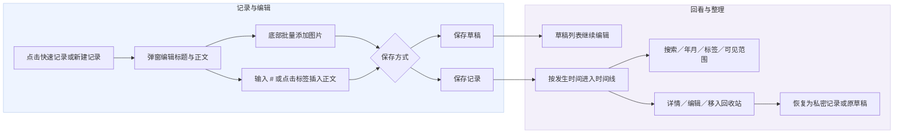
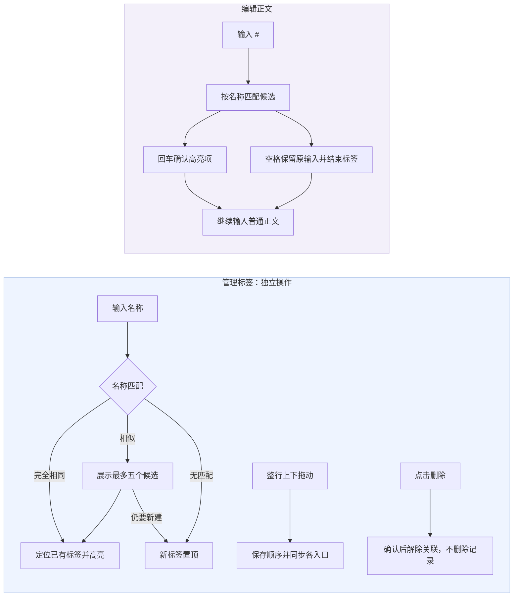
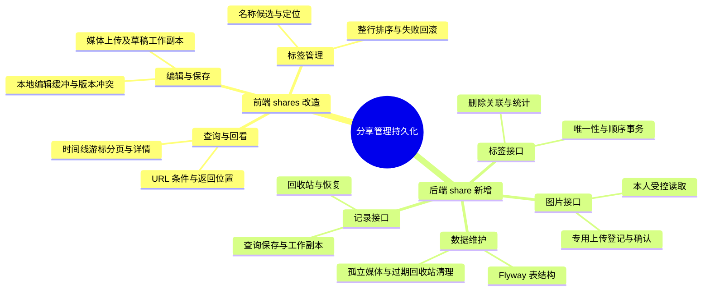
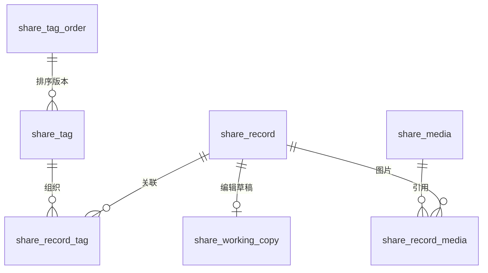
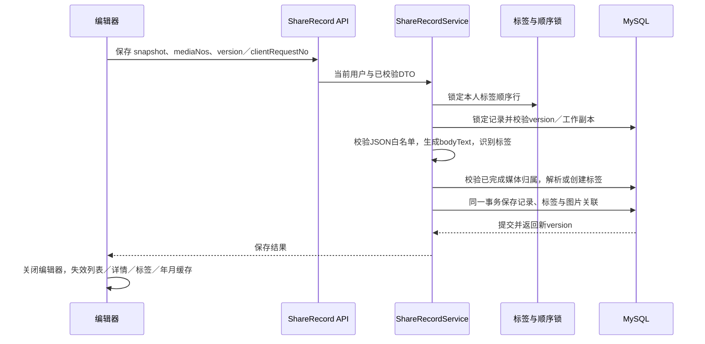
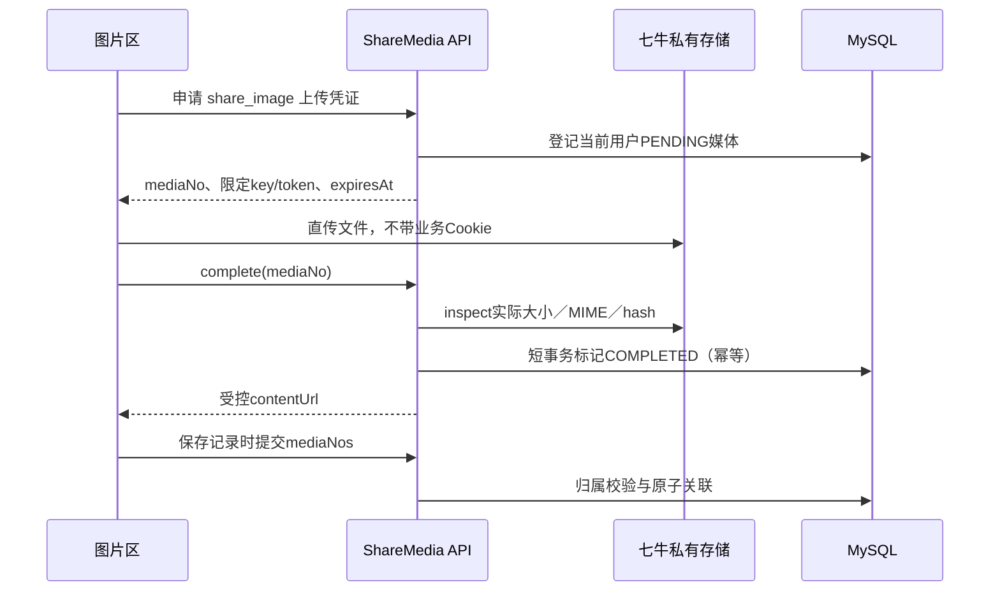

# 分享管理前后端技术设计

> 2026-11-03 增量已实现：时间线日期定位、数据库双向分页、持久浮窗列表和跨记录引用。见 [时间线定位与浮窗引用实现](时间线定位与浮窗引用实现.md)。

> 2026-11-03 实现状态：请同时阅读 [分享管理实现与验证](./分享管理实现与验证.md)。实际落库采用索引字段与 JSON 聚合快照，列表暂在应用层筛选分页；本文中的高容量 SQL 查询和部分扩展功能尚未落地，不能视为已完成验收。

> 评审稿 v0.1 · 2026-11-03。以本轮已确认页面交互为基线。本文是拟实现方案，不代表接口、数据库或真实上传已上线。
>
> 范围：React 管理端与共享 Java 后端。依据当前仓库及 `/Users/mainto/javafile/demand-workbench-backend` 源码。只新增本文，不修改旧产品草案和业务代码。

## 1. 目标、范围与关键结论

实现「记录—标签—时间线」的持久化闭环，保留当前轻量记录感；不增加新的业务模块。

| 本期落实 | 暂不加入 | 需要评审确认的建议 |
| --- | --- | --- |
| 富文本、独立图片区、手动草稿、编辑、详情、回收站 | 视频、文件、标签层级、合并、重命名、热力图、AI 提取 | 回收站保留期限；首版是否开放公开链接 |
| 关键词、可见范围、年月、单标签组合筛选 | 独立「筛选」按钮和高级筛选面板 | 正式记录编辑草稿采用独立工作副本 |
| 全量标签、手动顺序、整行拖动、删除、新增置顶、名称相似提示 | 自动频率排序、默认隐藏零记录标签、同义词语义匹配 | 分享专用私有媒体存储、访问凭证有效期 |

**当前可复用的能力：** React、Tiptap、Ant Design、TanStack Query、Cookie 会话、统一响应包装、七牛直传底层能力、MyBatis 与 Flyway。

**必须新增的能力：** 分享记录与标签接口、数据库表、记录媒体授权、草稿工作副本、可靠排序与防重复约束。现有页面的 `useState` / Data URL 图片属于演示实现，刷新会丢失，不能作为正式存储。

旧草案 `docs/prd/分享模块产品方案.md` 中的独立新建页、首页新建标签入口、未确认标签不识别等描述不是本次交付基线；下面以最新交互约定明确替代。公开页、自动保存等尚未最终确定的能力单独列出，不暗中扩入首版。

## 2. 用户操作闭环



### 2.1 编辑与阅读

- **入口：** 整个快速记录卡片和「新建记录」打开同一编辑弹窗，不新增第二套首页内联编辑器。
- **标题：** 选填，建议继续沿用 80 字；自动换行，单行到三行自适应；回车进入正文。聚焦底色保持白色。
- **正文：** 保存 Tiptap JSON；支持加粗、斜体、有序／无序列表、链接，以及浅红、浅橙、浅黄、浅绿、浅蓝、浅紫、浅灰和清除高亮。禁止正文图片节点、任意 HTML 和任意样式。
- **图片：** 独立于正文，最多 9 张、单张 10MiB、JPEG/PNG/WebP；批量添加保持选择顺序；悬停显示删除按钮；可放大预览。卡片最多显示三张，更多数量覆盖在第三张，预览可浏览全部。
- **放大模式：** 近乎撑满视口，只保留标题、正文、图片与右侧标签；配置项和底部操作暂时隐藏，缩小恢复。编辑器实例不重新创建，保留内容、撤销栈、光标与图片顺序。
- **关闭：** 有改动显示「保存草稿」「放弃修改」；点击确认框外围只取消确认，继续编辑。保存失败不关闭编辑器。
- **保存有效性：** 正式记录要求正文非空或至少一张上传成功的图片；草稿允许不完整。正文建议继续限制 20,000 个 Unicode 码点；前后端统一计数，不能一端用 UTF-16 长度、另一端用码点。
- **时间：** `occurredAt` 表达事情发生时间，`createdAt` 表达系统创建时间，`publishedAt` 表达首次对外发布时间。时间线按发生时间排列，历史补录不能改变创建时间。

### 2.2 标签管理与正文标签



| 场景 | 约定 |
| --- | --- |
| 首页标签 | 全部展开，包括零记录标签；≤16 单列，>16 两列，先向下再到右列；超高可滚动 |
| 管理排序 | 整行可拖，删除按钮除外；浮层跟随指针、占位与其他行让位、边缘滚动、松手高亮；删除保留确认 |
| 新建 | 去首尾空白和开头 #，忽略英文大小写判重；成功置顶、清空输入并保留焦点 |
| 相似提示 | 归一化后双向包含匹配，精确项优先，其余沿用户顺序，最多五个；不将摄影和拍摄自动视为同义 |
| 完全重名 | 前端按钮「定位已有标签」；后端唯一性兜底，不能因并发产生两个同名标签 |
| 首页点击 | 当前时间线加单标签条件，不跳新页；与关键词、可见范围和年月取 AND |
| 编辑器点击 | 插入当前正文光标；不触发首页筛选 |
| 正文回车 | 候选打开时确认高亮项，不换行；无候选时正常换段；输入法组合期间回车先交给输入法 |
| 正文空格 | 保留当前 # 后输入，不替换为候选；结束标签、后续为普通正文 |
| 标签计数 | 当前用户未删除的正式记录数，草稿不计；不随首页搜索变化 |

**标识与显示分开：** 正式接口关联 `tagNo`，不能用名称当主键。现有正文仍保留 `#名称` 文本，服务端按每个文本块合并后的文本识别，不能因加粗／颜色切分文本节点而漏标签。边界与现有解析一致：段首或空白后的 `#` 开始，空白或段尾结束，1–30 字，不识别 URL 内片段和 C#。保存时对同名归一化去重，建议沿用每条最多十个标签。

**删除后的正文（建议确认）：** 删除标签软删除标签及所有记录／工作副本关联，不批量改写用户正文；残留 `#名称` 显示普通文字。服务端解析遇到本人已删除标签不自动复活；只有用户明确新建同名标签时恢复该标签标识并置顶。以后保存含该文本的记录才重新关联，其他历史记录不批量恢复关联。候选与关联高亮仅使用有效标签集合。这样整理标签不会改变原文，也不会因再次保存原文偷偷把标签建回来。

## 3. 系统职责与模块划分



后端使用现有 Java 21 / Spring Boot / MyBatis / MySQL / Flyway；拟新增 `com.demandworkbench.share`，内部划分 controller、application、domain、infrastructure。分享独立于 requirement，不创建虚假需求以借用上传权限。

| 端 | 职责 | 不承担 |
| --- | --- | --- |
| React 页面／组件 | 交互、局部编辑内容、上传进度、拖动反馈 | 权限裁决、最终判重、信任 URL 作为附件 |
| share API / hooks | Zod、统一包装、Query 缓存、mutation、冲突处理 | 将服务器数据复制到全局状态 |
| ShareRecordService | 状态校验、正文校验、标签解析、关联事务、工作副本 | 直接依赖 HTTP 或七牛 SDK |
| ShareTagService | 用户隔离、归一化唯一性、排序版本、删除关联 | 自动相似语义合并 |
| ShareMediaService | 上传登记、云端核验、归属及记录访问控制 | 沿用需求协作权限 |
| Repository / 存储适配器 | MyBatis 事务、行锁、乐观版本、七牛私有桶适配 | 将私密文件永久静态公开 |

### 3.1 前端落地目录与状态

```text
features/shares/
  api/       shareRecordApi.ts / shareTagApi.ts / shareMediaApi.ts / shareSchemas.ts
  hooks/     useShareRecords.ts / useShareTags.ts / useShareMutations.ts
  components/ 当前编辑器、排序器、候选和详情组件
  pages/     SharePage.tsx
  types/     share.ts（替换对 shareDemo.ts 的类型依赖）
```

- Query Key：`['shares', actor, filters]`、`['shareDetail', actor, recordNo]`、`['shareTags', actor]`、`['sharePeriods', actor]`；切账号清理上个用户缓存。列表使用 infinite query，过滤条件改变重置游标。
- URL 建议持久化 `status,q,tagNo,visibility,period`，恢复时重新查询；年月是过滤，不宣称是已加载 DOM 的滚动跳转。保留加载更多前的位置，详情／编辑关闭回到原处。
- 关键词在输入组件局部即时回显，约 300ms 防抖后请求，可取消旧请求；排序拖动只更新管理列表临时顺序，不逐帧发接口。
- 松手后提交一次顺序；成功刷新标签缓存，首页／编辑器／候选同源；失败回滚并提示，409 拉取新顺序后允许重拖。排序请求中禁用下一次排序和新增／删除，避免覆盖自己的后续动作。
- 编辑器输入不逐键把完整 JSON 推到页面；保存时取 snapshot。保留现有文档变化才更新装饰、候选定位仅在需要时测量的策略。
- **首期手动保存。** 自动保存不是已实现或默认开启能力，后续如做，只保存草稿／工作副本，不自动公开。

## 4. 数据设计（拟新增）

所有表遵循后端规范：`deleted TINYINT DEFAULT 0`、`created_at/updated_at DATETIME(3)` 有数据库默认值，所有表列中文 COMMENT，无物理外键和业务枚举 CHECK。下表是迁移输入，不是已执行 DDL；索引和长度为设计建议。



| 表 | 核心字段（数据库名） | 约束与用途 |
| --- | --- | --- |
| share_record | id BIGINT、record_no VARCHAR(64)、owner_user_id BIGINT、title VARCHAR(80) 可空、document_json JSON、body_text MEDIUMTEXT、occurred_at DATETIME(3)、occurred_timezone VARCHAR(64)、status VARCHAR(16)、visibility VARCHAR(16)、version BIGINT、published_at DATETIME(3) 可空、deleted_at DATETIME(3) 可空、client_request_no VARCHAR(64)、request_hash CHAR(64) | record_no 唯一；(owner_user_id,client_request_no) 唯一；status 为 DRAFT/SAVED，deleted 独立；当前正式／新建草稿主记录 |
| share_working_copy | id、record_id BIGINT、owner_user_id、base_version BIGINT、draft_version BIGINT、payload_json JSON | record_id 唯一；编辑已有 SAVED 的草稿，不覆盖正式版本；payload 存正文、时间、可见范围、已完成 mediaNo 与解析后的 tagNo |
| share_tag | id、tag_no VARCHAR(64)、owner_user_id、name VARCHAR(30)、normalized_name VARCHAR(30)、sort_order BIGINT | tag_no 唯一；(owner_user_id,normalized_name) 唯一，包含已删除行；恢复重用原标识，不放开唯一约束 |
| share_tag_order | id、owner_user_id、version BIGINT | owner_user_id 唯一；同一用户新增／删除／排序／正文解析新增标签均先锁此行 |
| share_record_tag | id、record_id、tag_id、owner_user_id | (record_id,tag_id) 唯一；恢复关联更新 deleted；只表达主记录关联，工作副本不计入正式统计 |
| share_media | id、media_no、owner_user_id、scene、bucket、storage_key、original_name、mime_type、file_size、state、expires_at、completed_at、content_hash | media_no 唯一，(bucket,storage_key) 唯一；state 为 PENDING/COMPLETED；不存永久公开 URL |
| share_record_media | id、record_id、media_id、sort_order | (record_id,media_id) 唯一；独立图片排序。工作副本引用在 payload 内，清理任务同时检查两处 |

`id` 仅数据库内部使用，对外返回 `recordNo/tagNo/mediaNo` 字符串，不暴露 BIGINT 避免 JS 精度问题。业务所有者来自 `AuthenticatedUser.id()`，不接受前端传 ownerId。

**查询索引建议：** `share_record(owner_user_id,deleted,status,occurred_at,id)`；草稿查询增加 `(owner_user_id,deleted,status,updated_at,id)`；标签关联 `(owner_user_id,tag_id,deleted,record_id)`。初版关键词按本人 `title/body_text` 参数化 LIKE，转义 `%/_`；不承诺索引能加速包含检索，数据量证明需要后再引入搜索能力。

### 4.1 时间与分页

接口传 RFC3339 带偏移日期，例如 `2026-11-03T10:00:00+08:00`，另传 `occurredTimezone: Asia/Shanghai`。后端统一转换 UTC 存入 DATETIME(3)，读取显式转换；年月查询按 Asia/Shanghai 生成 UTC 半开区间，不能依赖 JVM／MySQL 默认时区。建议首版不允许未来发生时间，前后端提交时均校验到分钟。

正式记录按 `(occurred_at DESC,id DESC)`，草稿按 `(updated_at DESC,id DESC)`，回收站按 `(deleted_at DESC,id DESC)`。不透明 cursor 包含排序键和条件摘要，条件不匹配拒绝；查询 pageSize+1 判断 hasMore，首期建议20、最大50。跨页把同月分组连起来，不能重复显示月份。更新排序键可能导致实时分页漂移，返回列表时重置首屏并按 recordNo 去重，不承诺跨并发修改的快照一致性。

### 4.2 草稿与状态

| 操作 | 写入结果 | 用户可见结果 |
| --- | --- | --- |
| 新建保存草稿 | share_record.status=DRAFT，version=1 | 草稿列表可继续，主时间线不显示 |
| 新建保存记录／草稿转正式 | status=SAVED，更新关联并递增version | 出现在发生时间对应位置 |
| 已有正式记录「保存草稿」 | 更新 share_working_copy，保留base_version | 原正式内容／可见范围不变；草稿列表返回 EDIT_COPY，recordNo 仍指原记录 |
| 提交工作副本 | 校验主记录version及副本draftVersion；事务更新主记录并清除副本 | 列表更新，无重复记录 |
| 丢弃当前未保存修改 | 不发保存请求 | 保留此前服务器已存工作副本；不是删除服务器草稿 |
| 移入回收站 | deleted=1、deleted_at=now，保留status与关联，清除工作副本 | 列表和公开访问隐藏，草稿不再可编辑 |
| 恢复 | deleted=0；DRAFT仍DRAFT，SAVED强制PRIVATE；version递增 | 不自动重新公开 |

草稿列表合并新建草稿与正式记录的工作副本，每个 recordNo 最多一项。工作副本列表摘要、关键词、标签和可见范围筛选使用副本内容，不能借用正式版本的字段；排序及年月使用副本 updated_at。新建草稿也按修改时间过滤，回收站按 deleted_at 过滤，正式时间线按 occurred_at 过滤。

工作副本标签引用保存时即解析；新增标签可进入个人标签池，但计数为零。删除标签时同步删除工作副本里的 tagNo，正文文本保留。详情同时返回主记录与可选 workingCopy，打开编辑器有工作副本时提示「已恢复编辑草稿」，不能静默混淆正式版本。

建议回收站先不设自动永久删除；旧草案30天仅为提议，期限确认后再开发清理。媒体清理必须检查正式记录、草稿、工作副本及回收站保留引用。

## 5. 关键事务与调用



- **事务顺序：** 涉及标签的写入统一「用户标签顺序行 → 记录 → 关联」，删除标签涉及记录按内部ID升序锁；避免保存、排序、删除反向加锁。媒体云端请求不放进长时间数据库事务。
- **新建幂等：** `clientRequestNo` 每次新建会话生成并重试复用，载荷 hash 一致返回已有结果，不同返回409；更新由 version 防重复推进，响应丢失后重新查询确认，保留本地输入。
- **版本冲突：** 主记录、工作副本、标签顺序分别维护版本，过期返回409；不得用最后写入覆盖另一窗口。前端保留当前输入，提供刷新对比／另存新记录，不自动覆写。
- **标签并发：** 归一化名称使用明确大小写规则（建议 Unicode NFC + trim + 去前导# + Locale.ROOT lower；不做同义词／全半角合并）。查询归一化字段按二进制排序规则建立唯一索引，不能被 MySQL 默认重音／宽度折叠扩大判重范围。30字以码点计。
- **保存创建标签：** 首次出现的有效 #名称 在保存事务创建；并发同名复用，不能作为失败导致整条记录丢失。一次创建多个标签按正文首次出现顺序整体插到顶部；精确匹配到已删除标签按2.2处理，不自动复活。
- **标签删除：** 对正式关联软删除并清理工作副本引用，刷新计数；不改原记录正文、发生时间和更新时间，但受影响主记录version递增，使旧编辑窗口重新校验，避免带回已删除关系。



**图片边界：** 支持先上传后保存，不必提前创建空记录。申请凭证只需当前用户，不需要 requirementNo。重复完成确认幂等；网络超时后可重试确认。上传成功不等于记录已保存，移除图片先移除引用，不立即物理删除。

**失败与保留：** 上传失败可以重试单张；正式保存遇未完成图片阻断；保存草稿仅包含成功媒体，必须明确提示未完成图片不会保留。业务保存失败不回滚已完成上传，用户重试可复用原 mediaNo。

**访问：** 首版私密媒体读取先查当前所有者与有效引用，返回短期签名地址／302；建议5分钟有效但需评审。私有桶是前置条件，签名公开桶地址不能实现私密。公开转私密后短期签名仍可能在到期前有效，若要求立即失效应改为鉴权代理流式读取，并禁用公开缓存；不承诺已下载副本可撤回。

## 6. 接口契约（全部拟新增）

沿用后端仅 GET/POST、资源编号放 Query 的约束。鉴权使用现有 DW_SESSION；列表、详情、统计、标签、上传与读取均校验当前用户，越权与不存在统一404。

统一成功包装：`{success:true,msg:业务体,errorCode:null,errorMsg:null}`。失败用相应HTTP状态与 `{success:false,msg:null,errorCode:"...",errorMsg:"可读提示"}`，避免200业务失败被当前前端通用解包误归为格式错误。错误码为本方案拟定，接入时注册 share 错误域。

### 6.1 共用业务模型

| 模型／字段 | 类型 | 说明 |
| --- | --- | --- |
| RecordView.recordNo/title/bodyText | string/string或null/string | 业务编号；标题空为null；bodyText由后端生成 |
| RecordView.document | object | Tiptap doc；版本由独立 documentSchemaVersion 字段标识 |
| RecordView.documentSchemaVersion | number | 首期固定为1；不向Tiptap原生doc根节点混入版本字段 |
| RecordView.status/visibility/version | DRAFT或SAVED / PRIVATE或PUBLIC / number | 主记录状态、可见范围、乐观版本 |
| RecordView.occurredAt/occurredTimezone | string/string | 带偏移时间与IANA时区 |
| RecordView.createdAt/updatedAt/publishedAt/deletedAt | string；后两者可null | 系统时间，不供客户端覆盖 |
| RecordView.tags[] | TagView[] | 本记录有效标签，按个人顺序 |
| RecordView.images[] | MediaView[] | 全量图片，按sortOrder |
| RecordView.workingCopy | WorkingCopy或null | 仅本人详情返回；列表无此字段 |
| TagView | object | tagNo:string、name:string、recordCount:number、sortOrder:number |
| MediaView | object | mediaNo:string、mimeType:string、size:number、contentUrl:string、sortOrder:number；不含storageKey/token |
| WorkingCopy | object | draftVersion:number、baseVersion:number、updatedAt:string、payload:RecordInput |
| RecordInput | object | title:string或null、document:object、documentSchemaVersion:1、occurredAt:string、occurredTimezone:string、visibility:PRIVATE或PUBLIC、mediaNos:string[]；不接受ownerId/bodyText/tagNo列表 |
| RecordSummary | object | recordNo、title、bodyExcerpt（纯文本）、occurredAt、occurredTimezone、updatedAt、status、visibility、version、tags、imageCount、images（最多3个）、draftKind（NEW_RECORD/EDIT_COPY或null） |

列表摘要不拉取每条完整JSON；正文摘要保留换行，详情完整渲染。直接打开图片预览时取详情拿到全部images，不能把imageCount以外的图片伪造出来。TagView 不包含私密正文；零记录标签返回 recordCount=0。


### 6.2 查询与回显

#### 记录列表

| 项目 | 定义 |
| --- | --- |
| 请求 | `GET /api/v1/shares/records` |
| 参数位置 | Query |
| 身份 | 有效登录用户，仅本人数据 |
| 用途 | 记录列表；规则见本节末 |

| 请求字段 | 类型 | 约束／说明 |
| --- | --- | --- |
| status | string | Query，SAVED（默认）/DRAFT/TRASH |
| keyword | string | Query，可选，标题和正文包含匹配 |
| tagNo | string | Query，可选，仅本人有效标签 |
| visibility | string | Query，可选，PRIVATE/PUBLIC；不传为全部 |
| period | string | Query，可选，YYYY或YYYY-MM |
| cursor | string | Query，可选，后续页游标 |
| pageSize | number | Query，可选，默认20、最大50 |

| 响应字段（msg） | 类型 | 说明 |
| --- | --- | --- |
| items | RecordSummary[] | DRAFT含新建草稿及工作副本，recordNo去重 |
| nextCursor | string或null | 后续页凭证，无更多时null |
| hasMore | boolean | 是否有下一页 |
| matchedCount | number | 当前组合条件下总数，非当前页长度 |

**请求示例**

```http
GET /api/v1/shares/records?status=SAVED&period=2026-11&pageSize=20
```

**响应示例**

```json
{
  "success": true,
  "msg": {
    "items": [
      {
        "recordNo": "SHARE-01",
        "title": "记录一个想法",
        "bodyExcerpt": "记录一次思考 #成长",
        "occurredAt": "2026-11-03T10:00:00+08:00",
        "occurredTimezone": "Asia/Shanghai",
        "updatedAt": "2026-11-03T10:01:00+08:00",
        "status": "SAVED",
        "visibility": "PRIVATE",
        "version": 1,
        "tags": [
          {
            "tagNo": "TAG-01",
            "name": "成长",
            "recordCount": 1,
            "sortOrder": 0
          }
        ],
        "imageCount": 0,
        "images": [],
        "draftKind": null
      }
    ],
    "nextCursor": null,
    "hasMore": false,
    "matchedCount": 1
  },
  "errorCode": null,
  "errorMsg": null
}
```

无记录返回items=[]、matchedCount=0，查询失败返回错误，不能伪装空列表。普通标签计数不受本接口条件影响。

#### 记录详情

| 项目 | 定义 |
| --- | --- |
| 请求 | `GET /api/v1/shares/records/detail` |
| 参数位置 | Query |
| 身份 | 有效登录用户，仅本人数据 |
| 用途 | 记录详情；规则见本节末 |

| 请求字段 | 类型 | 约束／说明 |
| --- | --- | --- |
| recordNo | string | Query必填，本人记录编号 |

| 响应字段（msg） | 类型 | 说明 |
| --- | --- | --- |
| msg | RecordView | 包含完整正文、全部图片及可选workingCopy |

**请求示例**

```http
GET /api/v1/shares/records/detail?recordNo=SHARE-01
```

**响应示例**

```json
{
  "success": true,
  "msg": {
    "recordNo": "SHARE-01",
    "title": "记录一个想法",
    "occurredAt": "2026-11-03T10:00:00+08:00",
    "occurredTimezone": "Asia/Shanghai",
    "updatedAt": "2026-11-03T10:01:00+08:00",
    "status": "SAVED",
    "visibility": "PRIVATE",
    "version": 1,
    "tags": [
      {
        "tagNo": "TAG-01",
        "name": "成长",
        "recordCount": 1,
        "sortOrder": 0
      }
    ],
    "images": [],
    "bodyText": "记录一次思考 #成长",
    "document": {
      "type": "doc",
      "content": [
        {
          "type": "paragraph",
          "content": [
            {
              "type": "text",
              "text": "记录一次思考 #成长"
            }
          ]
        }
      ]
    },
    "documentSchemaVersion": 1,
    "createdAt": "2026-11-03T10:01:00+08:00",
    "publishedAt": null,
    "deletedAt": null,
    "workingCopy": null
  },
  "errorCode": null,
  "errorMsg": null
}
```

回收站本人可读详情但不可编辑；不存在／越权404。工作副本不覆盖主记录字段，前端显式选择恢复。

#### 可选年月

| 项目 | 定义 |
| --- | --- |
| 请求 | `GET /api/v1/shares/records/periods` |
| 参数位置 | Query |
| 身份 | 有效登录用户，仅本人数据 |
| 用途 | 可选年月；规则见本节末 |

| 请求字段 | 类型 | 约束／说明 |
| --- | --- | --- |
| status | string | Query，可选，SAVED/DRAFT/TRASH，默认SAVED |

| 响应字段（msg） | 类型 | 说明 |
| --- | --- | --- |
| years[] | object[] | 按年份倒序，仅当前用户该状态有记录的年月 |
| years[].year | number | 年份 |
| years[].months | number[] | 1–12倒序；前端另加全年选项 |

**请求示例**

```http
GET /api/v1/shares/records/periods?status=SAVED
```

**响应示例**

```json
{
  "success": true,
  "msg": {
    "years": [
      {
        "year": 2026,
        "months": [
          11
        ]
      }
    ]
  },
  "errorCode": null,
  "errorMsg": null
}
```

以首页约定展示时区分组；DRAFT按草稿修改时间提供可选年月，列表DRAFT的period也按修改时间过滤。

### 6.3 记录保存与回收站

#### 新建记录或草稿

| 项目 | 定义 |
| --- | --- |
| 请求 | `POST /api/v1/shares/records/create` |
| 参数位置 | JSON Body；资源编号在Query |
| 身份 | 有效登录用户，仅本人数据 |
| 用途 | 新建记录或草稿；规则见本节末 |

| 请求字段 | 类型 | 约束／说明 |
| --- | --- | --- |
| clientRequestNo | string | Body必填，客户端会话幂等编号 |
| action | string | Body必填，DRAFT/SAVE |
| record | RecordInput | Body必填，结构见共用模型 |

| 响应字段（msg） | 类型 | 说明 |
| --- | --- | --- |
| recordNo | string | 成功创建／幂等命中的编号 |
| status | string | DRAFT或SAVED |
| version | number | 当前主版本 |
| draftVersion | number或null | 本接口为null |

**请求示例**

```http
POST /api/v1/shares/records/create
```

```json
{
  "clientRequestNo": "CREATE-01",
  "action": "SAVE",
  "record": {
    "title": "记录一个想法",
    "documentSchemaVersion": 1,
    "document": {
      "type": "doc",
      "content": [
        {
          "type": "paragraph",
          "content": [
            {
              "type": "text",
              "text": "记录一次思考 #成长"
            }
          ]
        }
      ]
    },
    "occurredAt": "2026-11-03T10:00:00+08:00",
    "occurredTimezone": "Asia/Shanghai",
    "visibility": "PRIVATE",
    "mediaNos": []
  }
}
```

**响应示例**

```json
{
  "success": true,
  "msg": {
    "recordNo": "SHARE-01",
    "status": "SAVED",
    "version": 1,
    "draftVersion": null
  },
  "errorCode": null,
  "errorMsg": null
}
```

新建会话内重复提交不重复建记录。相同幂等键不同请求409；正文标签、媒体关联与主记录原子提交。公开未开放时PUBLIC返回409，不能偷偷改为私密后报告公开成功。

#### 更新记录或保存编辑草稿

| 项目 | 定义 |
| --- | --- |
| 请求 | `POST /api/v1/shares/records/save` |
| 参数位置 | JSON Body；资源编号在Query |
| 身份 | 有效登录用户，仅本人数据 |
| 用途 | 更新记录或保存编辑草稿；规则见本节末 |

| 请求字段 | 类型 | 约束／说明 |
| --- | --- | --- |
| recordNo | string | Query必填 |
| expectedVersion | number | Body必填，读取到的主记录version |
| expectedDraftVersion | number或null | Body；存在工作副本时必填其版本，无副本null |
| action | string | Body必填，DRAFT/SAVE |
| record | RecordInput | Body必填 |

| 响应字段（msg） | 类型 | 说明 |
| --- | --- | --- |
| recordNo/status/version | 同创建响应 | 主记录当前编号／状态／版本 |
| draftVersion | number或null | 写工作副本时返回版本；提交正式后null |

**请求示例**

```http
POST /api/v1/shares/records/save?recordNo=SHARE-01
```

```json
{
  "expectedVersion": 1,
  "expectedDraftVersion": null,
  "action": "DRAFT",
  "record": {
    "title": "记录一个想法",
    "documentSchemaVersion": 1,
    "document": {
      "type": "doc",
      "content": [
        {
          "type": "paragraph",
          "content": [
            {
              "type": "text",
              "text": "记录一次思考 #成长"
            }
          ]
        }
      ]
    },
    "occurredAt": "2026-11-03T10:00:00+08:00",
    "occurredTimezone": "Asia/Shanghai",
    "visibility": "PRIVATE",
    "mediaNos": []
  }
}
```

**响应示例**

```json
{
  "success": true,
  "msg": {
    "recordNo": "SHARE-01",
    "status": "SAVED",
    "version": 1,
    "draftVersion": 1
  },
  "errorCode": null,
  "errorMsg": null
}
```

主记录为DRAFT时更新主草稿并递增version；SAVED + DRAFT写工作副本而主version不变；SAVE正式提交同时校验工作副本版本并清除它。冲突409保留输入；已删除记录拒绝保存。

#### 移入回收站

| 项目 | 定义 |
| --- | --- |
| 请求 | `POST /api/v1/shares/records/trash` |
| 参数位置 | JSON Body；资源编号在Query |
| 身份 | 有效登录用户，仅本人数据 |
| 用途 | 移入回收站；规则见本节末 |

| 请求字段 | 类型 | 约束／说明 |
| --- | --- | --- |
| recordNo | string | Query必填 |
| expectedVersion | number | Body必填 |

| 响应字段（msg） | 类型 | 说明 |
| --- | --- | --- |
| recordNo | string | 目标记录 |
| version | number | 新版本 |
| deleted | boolean | 成功时true |

**请求示例**

```http
POST /api/v1/shares/records/trash?recordNo=SHARE-01
```

```json
{
  "expectedVersion": 2
}
```

**响应示例**

```json
{
  "success": true,
  "msg": {
    "recordNo": "SHARE-01",
    "version": 3,
    "deleted": true
  },
  "errorCode": null,
  "errorMsg": null
}
```

同一版本并发更新与删除只允许一个成功。已删除重复操作返回当前删除结果；工作副本被清除，图片保留引用，公开读取失效。

#### 恢复记录

| 项目 | 定义 |
| --- | --- |
| 请求 | `POST /api/v1/shares/records/restore` |
| 参数位置 | JSON Body；资源编号在Query |
| 身份 | 有效登录用户，仅本人数据 |
| 用途 | 恢复记录；规则见本节末 |

| 请求字段 | 类型 | 约束／说明 |
| --- | --- | --- |
| recordNo | string | Query必填 |
| expectedVersion | number | Body必填 |

| 响应字段（msg） | 类型 | 说明 |
| --- | --- | --- |
| recordNo | string | 恢复目标 |
| status | string | 原DRAFT或SAVED |
| visibility | string | 固定PRIVATE |
| version | number | 新主版本 |

**请求示例**

```http
POST /api/v1/shares/records/restore?recordNo=SHARE-01
```

```json
{
  "expectedVersion": 3
}
```

**响应示例**

```json
{
  "success": true,
  "msg": {
    "recordNo": "SHARE-01",
    "status": "SAVED",
    "visibility": "PRIVATE",
    "version": 4
  },
  "errorCode": null,
  "errorMsg": null
}
```

恢复不重新公开；已恢复的重试返回当前结果。被永久清理的记录404，不创建新记录。

### 6.4 标签查询与维护

#### 全部标签和顺序

| 项目 | 定义 |
| --- | --- |
| 请求 | `GET /api/v1/shares/tags` |
| 参数位置 | Query |
| 身份 | 有效登录用户，仅本人数据 |
| 用途 | 全部标签和顺序；规则见本节末 |

请求无参数。

| 响应字段（msg） | 类型 | 说明 |
| --- | --- | --- |
| items | TagView[] | 本人有效标签全量，包含零计数，按sortOrder |
| orderVersion | number | 集合版本，用于新增／排序／删除冲突检查 |

**请求示例**

```http
GET /api/v1/shares/tags
```

**响应示例**

```json
{
  "success": true,
  "msg": {
    "items": [
      {
        "tagNo": "TAG-01",
        "name": "成长",
        "recordCount": 1,
        "sortOrder": 0
      }
    ],
    "orderVersion": 5
  },
  "errorCode": null,
  "errorMsg": null
}
```

无标签返回空数组和当前集合版本。相似候选在浏览器基于该集合计算，不逐键调用接口。未来超大标签量再按证据改为服务端搜索。

#### 创建或恢复标签

| 项目 | 定义 |
| --- | --- |
| 请求 | `POST /api/v1/shares/tags/create` |
| 参数位置 | JSON Body；资源编号在Query |
| 身份 | 有效登录用户，仅本人数据 |
| 用途 | 创建或恢复标签；规则见本节末 |

| 请求字段 | 类型 | 约束／说明 |
| --- | --- | --- |
| name | string | Body必填，归一化后1–30码点，内部不允许空白和# |
| expectedOrderVersion | number | Body必填，当前集合版本 |

| 响应字段（msg） | 类型 | 说明 |
| --- | --- | --- |
| tag | TagView | 新建／复用目标 |
| created | boolean | 是否新建物理标签 |
| restored | boolean | 是否恢复本人已删除同名标签 |
| orderVersion | number | 操作后集合版本 |

**请求示例**

```http
POST /api/v1/shares/tags/create
```

```json
{
  "name": "成长",
  "expectedOrderVersion": 5
}
```

**响应示例**

```json
{
  "success": true,
  "msg": {
    "tag": {
      "tagNo": "TAG-01",
      "name": "成长",
      "recordCount": 1,
      "sortOrder": 0
    },
    "created": false,
    "restored": false,
    "orderVersion": 5
  },
  "errorCode": null,
  "errorMsg": null
}
```

精确同名返回已有标签且不改顺序；新建／恢复放第一位并递增集合版本。过期版本409重新拉取判断。相似但不同名允许创建，后端不做语义合并。

#### 保存完整标签顺序

| 项目 | 定义 |
| --- | --- |
| 请求 | `POST /api/v1/shares/tags/reorder` |
| 参数位置 | JSON Body；资源编号在Query |
| 身份 | 有效登录用户，仅本人数据 |
| 用途 | 保存完整标签顺序；规则见本节末 |

| 请求字段 | 类型 | 约束／说明 |
| --- | --- | --- |
| expectedOrderVersion | number | Body必填 |
| tagNos | string[] | Body必填，包含本人所有有效标签且恰好各一次 |

| 响应字段（msg） | 类型 | 说明 |
| --- | --- | --- |
| orderVersion | number | 原子提交后的集合版本 |

**请求示例**

```http
POST /api/v1/shares/tags/reorder
```

```json
{
  "expectedOrderVersion": 5,
  "tagNos": [
    "TAG-01"
  ]
}
```

**响应示例**

```json
{
  "success": true,
  "msg": {
    "orderVersion": 6
  },
  "errorCode": null,
  "errorMsg": null
}
```

锁用户顺序行，完整校验集合、归属和版本，再批量更新sortOrder。重复／遗漏／多出标签400，版本过期409；全部成功或全部回滚。按当前有效列表定位不能将另一用户标签带入。

#### 删除标签

| 项目 | 定义 |
| --- | --- |
| 请求 | `POST /api/v1/shares/tags/delete` |
| 参数位置 | JSON Body；资源编号在Query |
| 身份 | 有效登录用户，仅本人数据 |
| 用途 | 删除标签；规则见本节末 |

| 请求字段 | 类型 | 约束／说明 |
| --- | --- | --- |
| tagNo | string | Query必填 |
| expectedOrderVersion | number | Body必填 |

| 响应字段（msg） | 类型 | 说明 |
| --- | --- | --- |
| tagNo | string | 已删除目标 |
| orderVersion | number | 新集合版本 |
| affectedRecordCount | number | 实际解除的未删除正式记录数量 |

**请求示例**

```http
POST /api/v1/shares/tags/delete?tagNo=TAG-01
```

```json
{
  "expectedOrderVersion": 6
}
```

**响应示例**

```json
{
  "success": true,
  "msg": {
    "tagNo": "TAG-01",
    "orderVersion": 7,
    "affectedRecordCount": 1
  },
  "errorCode": null,
  "errorMsg": null
}
```

删除前确认展示当前正式关联数。清理关联包含草稿、回收站和工作副本；响应数量仅按正式计数口径，不删除任何记录正文。更新受影响主版本；工作副本引用变化时同步递增 draftVersion，保留原 baseVersion，旧编辑器提交收到409后重新载入并由用户确认。已删除目标重试返回现状，不重复扣计数。

### 6.5 图片上传与访问

#### 申请图片直传凭证

| 项目 | 定义 |
| --- | --- |
| 请求 | `POST /api/v1/shares/media/upload-token` |
| 参数位置 | JSON Body；资源编号在Query |
| 身份 | 有效登录用户，仅本人数据 |
| 用途 | 申请图片直传凭证；规则见本节末 |

| 请求字段 | 类型 | 约束／说明 |
| --- | --- | --- |
| scene | string | Body必填，固定share_image |
| filename | string | Body必填，仅文件名，服务端清理控制字符与路径 |
| mimeType | string | Body必填，image/jpeg、image/png、image/webp |
| size | number | Body必填，1–10485760字节 |

| 响应字段（msg） | 类型 | 说明 |
| --- | --- | --- |
| mediaNo | string | 本次登记编号 |
| key/token/uploadUrl | string | 限定对象的临时直传信息，不作为记录内容保存 |
| expiresAt | number | Unix秒，具体有效期沿存储配置 |

**请求示例**

```http
POST /api/v1/shares/media/upload-token
```

```json
{
  "scene": "share_image",
  "filename": "example.jpg",
  "mimeType": "image/jpeg",
  "size": 2048
}
```

**响应示例**

```json
{
  "success": true,
  "msg": {
    "mediaNo": "SMEDIA-01",
    "key": "shares/2026/11/SMEDIA-01.jpg",
    "token": "UPLOAD_TOKEN_PLACEHOLDER",
    "uploadUrl": "https://upload.example.invalid",
    "expiresAt": 1793671800
  },
  "errorCode": null,
  "errorMsg": null
}
```

现有 /task-media/upload-token 强制requirementNo，不直接调用。复用DirectMediaStorage边界时核对其私有桶配置是否能独立注入，不能切换旧任务素材桶影响存量任务。

#### 确认图片上传完成

| 项目 | 定义 |
| --- | --- |
| 请求 | `POST /api/v1/shares/media/complete` |
| 参数位置 | JSON Body；资源编号在Query |
| 身份 | 有效登录用户，仅本人数据 |
| 用途 | 确认图片上传完成；规则见本节末 |

| 请求字段 | 类型 | 约束／说明 |
| --- | --- | --- |
| mediaNo | string | Query必填，本人登记编号 |

| 响应字段（msg） | 类型 | 说明 |
| --- | --- | --- |
| mediaNo | string | 已完成媒体 |
| mimeType/size | string/number | 云端探测并通过校验的属性 |
| contentUrl | string | 受控读取接口，不是永久公开地址 |

**请求示例**

```http
POST /api/v1/shares/media/complete?mediaNo=SMEDIA-01
```

```json
{}
```

**响应示例**

```json
{
  "success": true,
  "msg": {
    "mediaNo": "SMEDIA-01",
    "mimeType": "image/jpeg",
    "size": 2048,
    "contentUrl": "/api/v1/shares/media/content?mediaNo=SMEDIA-01"
  },
  "errorCode": null,
  "errorMsg": null
}
```

无额外Body字段。服务端inspect实际文件，必须和登记大小及类型相符；上传者才可确认；重复确认不新增媒体。此时尚未关联记录，允许上传者预览。

#### 读取本人图片

| 项目 | 定义 |
| --- | --- |
| 请求 | `GET /api/v1/shares/media/content` |
| 参数位置 | Query |
| 身份 | 有效登录用户，仅本人数据 |
| 用途 | 读取本人图片；规则见本节末 |

| 请求字段 | 类型 | 约束／说明 |
| --- | --- | --- |
| mediaNo | string | Query必填 |

**请求示例**

```http
GET /api/v1/shares/media/content?mediaNo=SMEDIA-01
```

**响应示例**

```http
HTTP/1.1 302 Found
Location: https://private.example.invalid/signed-object
Cache-Control: private, no-store
```

本接口是媒体传输例外：成功302且Location为限时签名URL，不使用JSON包装；签发响应Cache-Control: private,no-store。校验本人媒体且已完成，临时未关联媒体仅上传者可预览；已关联图片还须有未删除记录或保留工作副本／回收站管理读取权限。公开访客不得走此接口。

### 6.6 错误与恢复（拟定错误码）

| HTTP / errorCode | 触发 | 前端行为 |
| --- | --- | --- |
| 400 SHARE_INVALID | 格式、正文节点、字数、未来时间、非法标签集合 | 定位字段，保留全部编辑内容 |
| 401（沿用身份域编码） | 登录过期 | 走现有登录恢复，不自动提交公开内容 |
| 404 SHARE_NOT_FOUND / SHARE_TAG_NOT_FOUND / SHARE_MEDIA_NOT_FOUND | 不存在或越权 | 不泄露资源所有者，不作为空成功 |
| 409 SHARE_VERSION_CONFLICT | 主记录或草稿版本过期 | 保留本地输入，读取最新版本供对比 |
| 409 SHARE_TAG_ORDER_CONFLICT | 标签集合版本过期 | 回滚拖动并重新加载，允许再次操作 |
| 409 SHARE_IDEMPOTENCY_CONFLICT | 相同幂等键不同载荷 | 不重复创建，提示重新打开新建会话 |
| 409 SHARE_PUBLIC_NOT_ENABLED | 尚未开放公开 | 不伪装保存成功，提示切私密或保留草稿 |
| 400 SHARE_MEDIA_INVALID / 503 SHARE_STORAGE_UNAVAILABLE | 图片非法／存储不可用 | 对应图片失败并可重试，不丢其他输入 |

前端现有 `apiResponseSchema` 对200的业务失败会产生Zod失败，故新增接口不返回200失败。`requestJson` 对401/404/409等非2xx已能读取errorCode/errorMsg；只在功能API层适配，不顺带改变已有模块行为。

## 7. 公开与隐私边界

页面当前 PUBLIC 仅是演示状态，不意味着已有公开阅读接口。建议本期优先交付私密闭环；后端返回能力开关，由配置明确是否支持公开，未支持时选择器只展示「仅自己可见」，不能让用户保存一个实际不可访问的公开承诺。能力读取可并入既有初始化响应或另定接口，评审时确定，不假设已有字段。

若首发必须公开，应追加独立设计与上线验收：公开ID生成、匿名只读接口、内容审核策略、正式公开版本与编辑草稿隔离、媒体匿名授权、转私密撤销与缓存策略。公开只读页不得暴露个人标签全集、私密记录统计、联系方式或未提交工作副本。正式公开版本只在显式确认提交后变化。

本方案的 `visibility=PUBLIC` 和 `publishedAt` 是预留模型；公开开关关闭时拒绝 PUBLIC 正式保存。私密保存不设置 publishedAt，编辑时不使用客户端时间覆盖系统字段。

## 8. 交付拆分与兼容

| 阶段 | 前端 | 后端 | 验收出口 |
| --- | --- | --- | --- |
| 1 私密文字闭环 | API/schema/hooks、替换演示状态、列表详情、主草稿与工作副本 | Flyway、记录／标签／排序接口、鉴权、版本 | 保存后刷新仍存在；双账号隔离；跨窗口冲突 |
| 2 图片闭环 | FileReader Data URL改为临时Object URL+真实上传；进度／重试 | 独立私有媒体登记、确认、读取、引用校验 | 批量上传→保存→刷新→预览；未授权访问失败 |
| 3 整体收口 | URL条件、游标加载、空态／错误态、焦点与返回位置 | 查询索引／统计一致性、回收站恢复、清理策略 | 20+标签、长列表、拖动失败回滚、多页查询 |
| 4 可选公开 | 独立公开阅读入口、显式公开确认 | 公开读取与审核／缓存边界 | 对外访问与转私密撤销满足明确策略 |

**上线顺序：** 先兼容新增表和接口，再部署前端接入；缺少分享接口时显示明确错误，不回退演示数据冒充真实记录。Flyway版本在实施时按实际当前迁移序列生成，不提前占用时间编号。

**演示数据：** 现有 initialRecords、远端示例图片和20个预置标签不自动写入真实用户数据库；首次进入真实账号为空态。若需要保留演示输入，由用户显式导入，不能将Data URL直接塞入主记录JSON。

**媒体维护：** 临时PENDING／未引用COMPLETED需过期清理，建议定时任务锁定候选、复核引用、延迟删除；具体期限待确认。删除云对象失败可重试，不在业务保存事务同步删对象；未上线清理前监控孤立数量。不能仅扫描share_record_media而误删工作副本图片。

**配置与限额：** 上传密钥仅后端配置；私有存储未就绪时关闭图片上传并解释原因。正文JSON大小、节点深度和节点数量需配置上限，防止仅字数校验遗漏超大属性／嵌套载荷，具体值实施时压测确定。

## 9. 验收场景与风险检查

| 场景 | 必须证明的结果 |
| --- | --- |
| 新建与刷新 | 保存一次只生成一条；刷新可回显正文、高亮、标签、图片顺序与时间 |
| 历史补录 | 今天补录2019年发生的记录，主时间线落在2019年，createdAt仍为今天 |
| 草稿分离 | 编辑正式记录保存草稿，原内容及可见范围不变；草稿入口能恢复工作副本 |
| 多窗口编辑 | 旧version保存返回409，本地输入不清空，不覆盖另一窗口 |
| 相似与重名 | 输入「产品」显示「产品设计」；输入空白/#/大小写变体不能建重名；相似不同名可建 |
| 并发新建标签 | 两窗口同名最终只有一个；旧orderVersion收到明确冲突并重读 |
| 标签排序 | 整行拖动、触屏、键盘、长列表自动滚动；只松手提交；失败回到服务器顺序 |
| 标签删除 | 删除不删记录，正文保留；不因再次保存原文自动复活；工作副本和计数同步 |
| 两列与计数 | 16个单列、17个双列；先左下再右列；零计数不隐藏；排序在各入口一致 |
| 正文 # | 回车选候选不换行；空格保留输入；中文组合输入不提前确认；跨加粗节点仍识别 |
| 图片 | 九张／10MiB边界、非法MIME、乱序完成保持选择顺序、重试、未完成阻断正式提交 |
| 图片预览 | 关闭不闪回前一张；返回不丢正文光标；移除只解除引用 |
| 越权 | 另一账号无法列表、详情、搜索、统计、关联标签、确认上传或读私密图片 |
| 回收站 | 删除隐藏，恢复默认私密，草稿恢复仍草稿；不自动公开 |
| 查询与返回 | 组合条件AND，年月含正确时区边界，同刻记录分页无重复；清条件与返回位置正确 |
| 公共故障 | 断网／登录失效／存储失败／响应格式不符均有真实错误，不伪装空态或保存成功 |

实施验证按项目变更风险执行：领域解析与状态机单测、API契约测试、真实MySQL迁移与事务／唯一性／并发集成验证；浏览器完成「新增→上传→保存→刷新→排序→筛选→编辑草稿→删除恢复」及双账号越权。七牛替身不能替代真实私有桶、CORS、签名访问联调。本文档阶段未执行上述业务测试。

## 10. 本轮需要确认的决策

1. **公开首发：** 建议先交付私密闭环；若必须首发公开，需一并确定审核和媒体撤销策略。
2. **工作副本：** 建议保留独立工作副本，使已有正式记录「保存草稿」不会下线或覆盖原内容；此处是对当前演示的必要补齐。
3. **删除标签后的 #文本：** 建议保留原文、解除关联且不自动复活；显式新建同名才恢复标签。是否接受该规则？
4. **回收站期限：** 建议首期人工恢复、不自动清空；若采用旧草案30天，应明确到期清理和告知方式。
5. **自动保存：** 本期手动；如要求自动保存，增加工作副本防抖、失败恢复和可见保存状态，不自动公开。

## 附录：可追溯实现依据

- 前端：`src/features/shares/SharePage.tsx`、`ShareEditor.tsx`、`ShareRichEditor.tsx`、`ShareTagAdd.tsx`、`ShareTagSorter.tsx`、`shareTags.ts`、`shareHighlight.ts`。
- 请求与上传：`src/shared/api/httpClient.ts`、`apiResponseSchema.ts`、`src/features/media/api/mediaUploadApi.ts`。
- 后端：`com/demandworkbench/identity/controller/UserController.java`（身份获取）、`common/ApiResponse.java`（包装）、`discovery/controller/MediaUploadController.java` 与 `application/MediaUploadService.java`（需求绑定上传，不能直接用）、`application/DirectMediaStorage.java`（拟复用边界）。路径均相对共享后端 `src/main/java/`。
- 约束：前后端 AGENTS.md、前端架构／接口与状态管理规范、后端 architecture.md / api.md；旧产品草案仅作为需求来源之一，不覆盖最新会话结论。

本文包含可编辑 Mermaid 图源、模型和逐接口契约；所有新增路径、表名和错误码均为评审设计。未修改运行中服务、业务代码、PRD或数据库。
