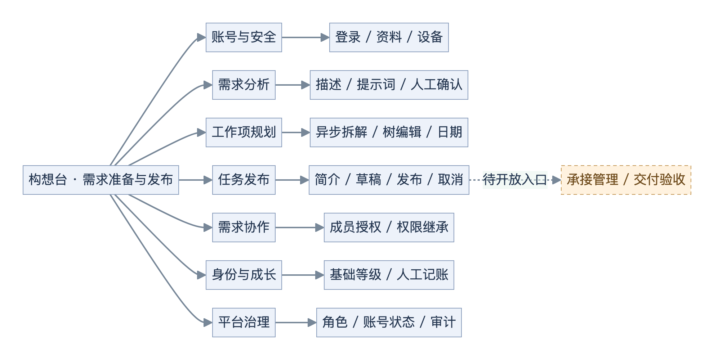
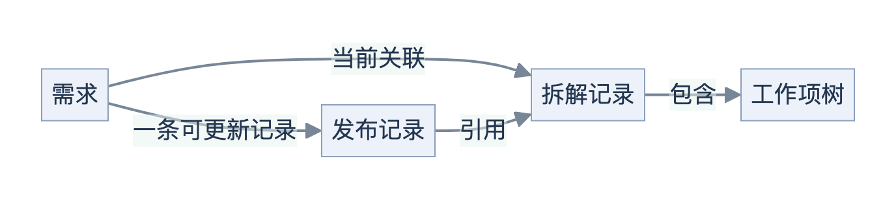
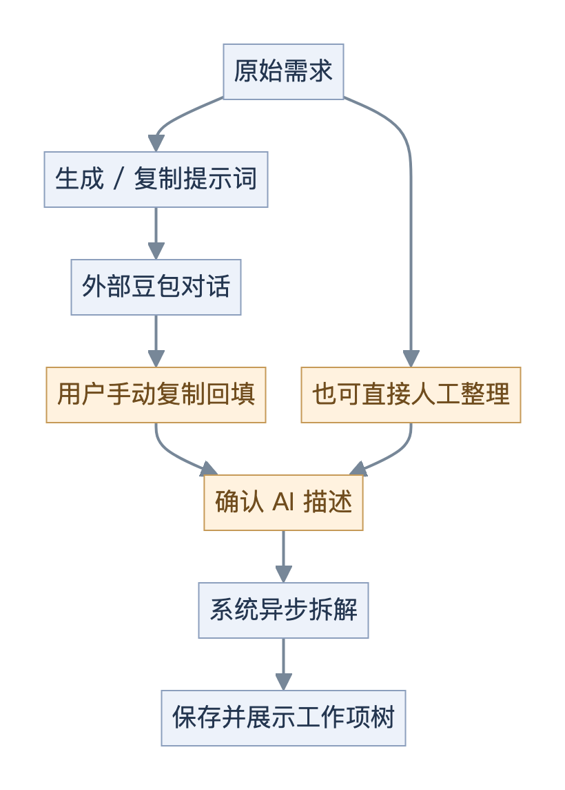
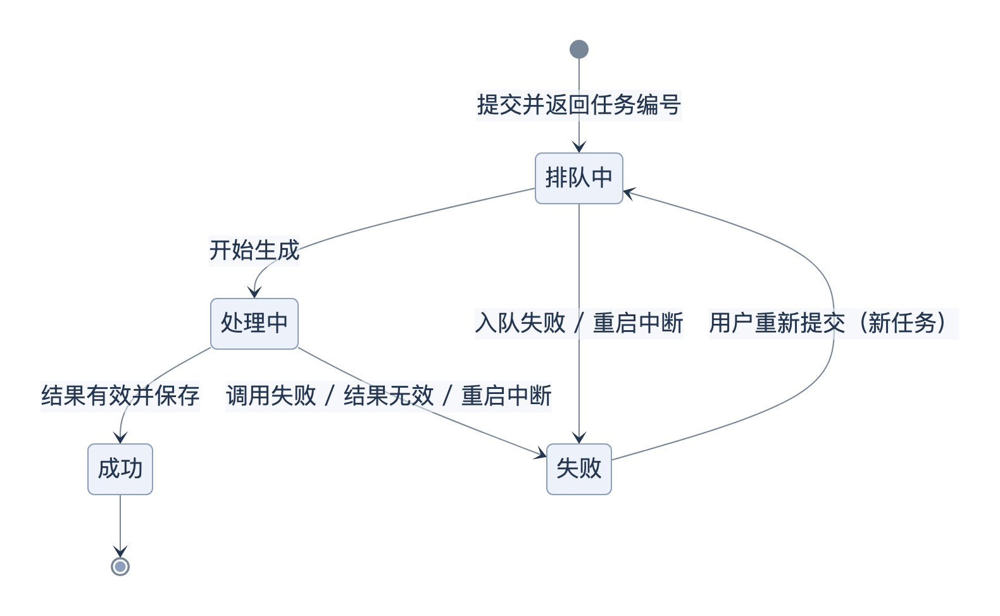
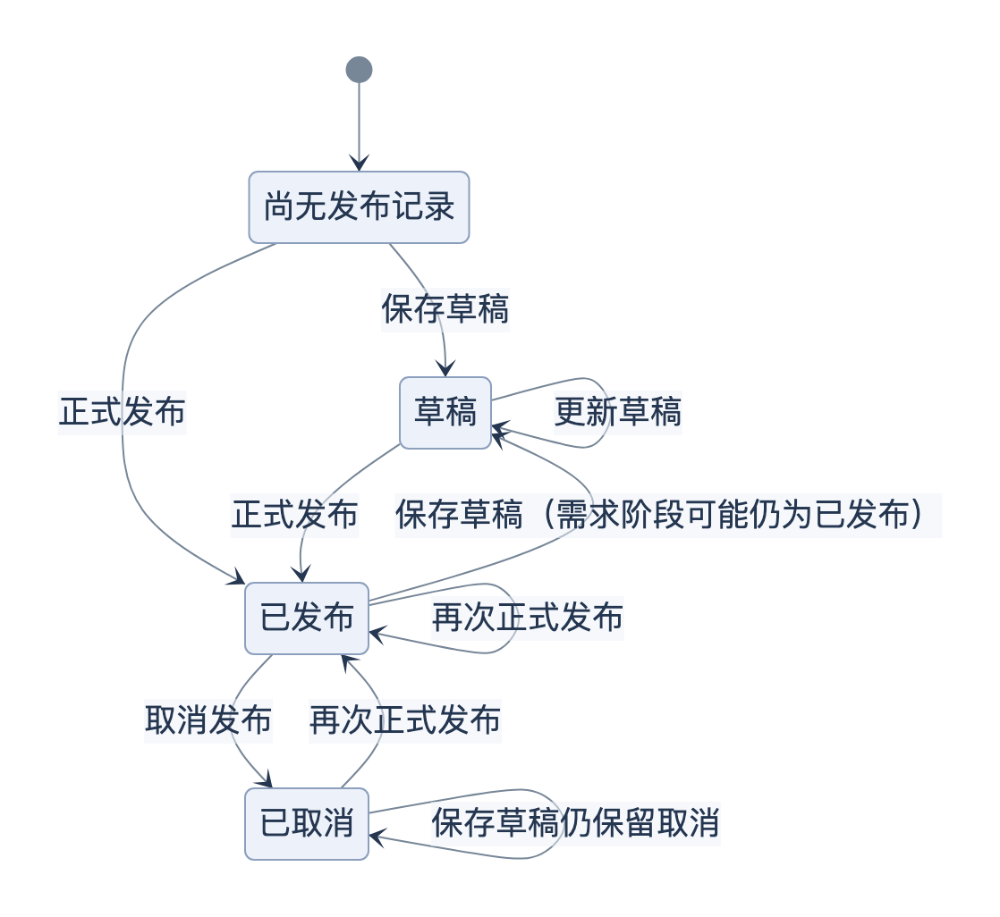
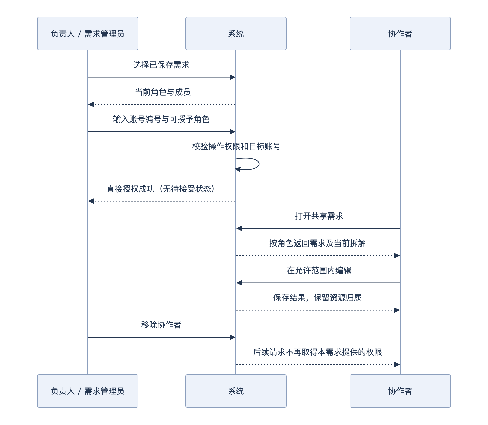
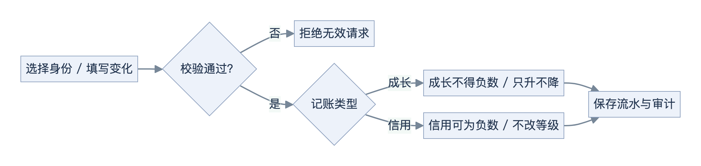

# 构想台 · 产品需求文档

> v0.2｜2026-10-24｜源码现状稿 · 待评审｜负责人：待指定｜确认日期：未确认。

**阅读约定：**“源码已实现”不等于运行验证通过；本次只核对源码与文档，没有启动业务系统验收。规则编号用于讨论和测试追溯，不表示规则已经评审批准；已知问题与后续范围单列在第 5 章。

## 1. 产品概览

### 1.1 产品定位

将原始想法整理成可编辑的工作项，并形成可保存、发布和取消的任务。

面向提出需求的发布人、共同整理需求的协作者，以及维护账号规则的运营和管理员。

**贯穿示例：**发布人输入“预约系统”的想法，人工确认分析文本；系统拆解后，发布人修订工作范围和日期，再完善简介与承接条件，保存草稿或正式发布。示例只帮助理解现有主线，不增加预约系统的业务需求。

**当前产品是需求准备与发布工作台。** 承接身份可以开通，但报名、接单、交付、验收、结算尚未形成业务闭环。

### 1.2 功能地图

图 01｜产品由哪些模块组成



实线表示现有模块，虚线表示待开放入口。实现与验证状态集中见 1.4，不在地图和模块导航中重复列状态。

### 1.3 用户角色

同一用户可以同时具有业务身份、需求协作角色和平台角色，三者分别决定不同权限。

| 角色维度 | 当前角色 | 决定什么 | 不代表什么 |
| --- | --- | --- | --- |
| 业务身份 | 发布人 L0–L5；承接人 J1–J20 | 发布资格、身份等级、各自成长和信用 | 不授予平台管理权 |
| 需求协作 | 负责人、需求管理员、编辑者、查看者 | 某个需求及其当前关联拆解的操作范围 | 不等于平台角色 |
| 平台管理 | 普通用户、运营人员、平台管理员 | 账号、成长规则、人工调整和审计权限 | 不自动获得他人需求的编辑权 |

### 1.4 实现与验证状态

实现口径：**源码已实现**＝代码可确认该范围的完整行为；**部分实现**＝有可用子能力但链路不全；**未实现**＝有明确入口但无对应业务；**待确认**＝不足以确定定义。下表所有能力的**运行验证状态均为本次未验证**，不引用历史测试作为本版验收结论。

| 能力 | 状态 | 需要先知道的边界 |
| --- | --- | --- |
| 登录、会话、退出 | 部分实现 | 开发验证码；详见 4.1 |
| 资料、有效设备、安全记录 | 源码已实现 | 昵称可改；手机号只读；可退出其他设备 |
| 需求列表、新建、保存、删除 | 部分实现 | 新建先在本地；进入任务发布前才明确保存需求 |
| AI 辅助分析 | 源码已实现 | 外部对话需人工复制回填，不自动同步 |
| 附件和编辑工具栏 | 部分实现 | 页面附件是样例，无真实上传闭环；部分按钮无行为 |
| 异步 AI 拆解、工作项维护 | 源码已实现 | 依赖可用模型；工作项编辑需要已有拆解编号 |
| 甘特图、工作项依赖 | 部分实现 | 展示日期条并打开编辑；没有自动排期和真实依赖关系 |
| 简介、发布草稿、正式发布、取消 | 源码已实现，存在已知问题 | 范围保存和状态口径见 P01–P03，不代表发布过程无缺陷 |
| 招募条件、预算、可见范围 | 部分实现 | 可以保存字段，没有报名、计费或公开分发 |
| 需求协作授权 | 源码已实现 | 直接授权；不是实时共同编辑；详见 4.7 |
| 身份等级与成长 | 部分实现 | 默认基础等级；高级门槛默认停用；仅人工记账 |
| 平台角色、账号状态、管理审计 | 源码已实现 | 固定角色；近期账号和审计各最多 100 条 |
| 工作台、承接管理、交付验收 | 未实现 | 侧栏有入口，点击提示后续开放 |
| 公开招募规则、奖惩和交付机制 | 待确认 | 不能根据表单选项或等级名称推导完整规则 |

## 2. 核心业务流程

### 2.1 从想法到发布

图 02｜一条需求如何形成发布记录


总览只展示成功路径；异步失败与重试见 4.3。发布权限和资格见 4.6，正式发布后可取消。

### 2.2 数据保存与恢复规则

> **R-SAVE-01：分析页中的新建和文本修改，目前不保证刷新后恢复。** 点击“任务发布”会先保存需求；保存工作项或看到拆解结果，均不能替代这个动作。

| 用户操作 | 实际保存结果 | 刷新或重进时的边界 |
| --- | --- | --- |
| 点击新建、修改标题或分析文本 | 本地需求状态发生变化 | 分析页没有独立保存按钮，不能视为已保存到服务端 |
| 提交 AI 拆解并成功 | 拆解记录和工作项已保存 | 尚未保存需求时，不保证刷新后找回该需求与拆解关联 |
| 保存、删除工作项 | 独立更新已有拆解的工作项 | 不等于保存需求文本或发布任务 |
| 点击“任务发布” | 先保存需求，再进入发布向导 | 获得正式需求编号，记录当前拆解关联 |
| 保存草稿、正式发布、取消 | 保存或更新同一需求的发布记录 | 是三个不同操作，不等同于需求文本保存 |

上述规则是保存与恢复行为的统一说明，其他章节引用本节，不重复展开。

### 2.3 核心业务对象

图 03｜一条需求如何关联拆解、工作项和发布记录



需求保留“当前拆解”的引用，工作项属于拆解，发布记录引用该拆解。账号身份及账目关系见 4.8–4.9；发布选中范围的保存边界只在 4.6 说明。

## 3. 功能模块

### 3.1 功能导航

| 模块 | 用途 | 详情 |
| --- | --- | --- |
| M01 账号与安全 | 进入产品，管理本人账号 | 4.1 |
| M02 需求分析 | 确认可拆解的文本 | 4.2 |
| M03 工作项规划 | 生成并修订工作范围 | 4.3–4.4 |
| M04 任务发布 | 整理简介和发布条件 | 4.5–4.6 |
| M05 需求协作 | 授权指定账号共同整理 | 4.7 |
| M06 身份与成长 | 查看资格与独立账目 | 4.8–4.9 |
| M07 平台治理 | 管理角色、状态和审计 | 4.10 |

### 3.2 页面与入口

| 页面或区域 | 主要操作 | 去向或结果 |
| --- | --- | --- |
| 登录门禁 | 手机号、获取验证码、验证登录 | 进入工作区；不是独立登录路由 |
| 需求列表 | 搜索、新建、打开、负责人删除、取消发布 | 分析页或状态更新 |
| 分析工作区 | 原始描述、AI 描述、预览、外部分析、拆解 | 工作项规划；进入发布前保存需求 |
| 工作项规划 | 树状编辑、抽屉、选择、日期与甘特图 | 修订当前拆解；可进入发布 |
| 发布向导 | 发布内容 → 承接要求 → 确认发布 | 保存草稿或正式发布 |
| 个人设置 | 资料、安全、身份、协作权限 | 保存资料、管理会话、开通承接身份 |
| 管理控制台 | 按权限显示账号、成长、审计页签 | 执行管理动作并留下记录 |

列表的筛选、排序、视图切换、通知按钮，以及规划中的导入、筛选、排序，不应视为已实现能力。工作台、承接管理、交付验收仍是占位入口。

### 3.3 关键操作前置条件

| 需要完成的动作 | 业务依赖 | 影响范围 |
| --- | --- | --- |
| 查看或维护需求 | 登录、需求归属或协作授权 | 分析、规划、发布、成员管理 |
| 保存工作项 | 有效拆解编号、编辑权限 | 树状数据与甘特图 |
| 正式发布 | 已保存需求、关联拆解、发布权限、操作人发布资格 | 发布记录与需求阶段 |
| 访问共享拆解 | 需求当前关联该拆解，且用户仍有对应授权 | 拆解、工作项、简介 |
| 调整成长或信用 | 平台管理权限、正常账号和有效业务身份 | 独立账目、等级、流水、审计 |

## 4. 详细功能

### 4.1 登录、个人资料与安全

让用户进入产品，查看本人信息并管理有效登录设备。入口为登录门禁和个人设置。

| 页面区域 | 用户操作 | 系统结果与规则 |
| --- | --- | --- |
| R-AUTH-01 手机验证 | 请求验证码后提交 | 当前固定码 `123456`；有效 5 分钟，成功使用后消费一次；没有真实短信 |
| 首次登录 | 使用新手机号完成验证 | 创建账号、手机号已验证、默认普通用户；发布人基础等级默认 L1 |
| 登录会话 | 登录、退出 | 会话默认 30 天，可由部署配置改变；退出撤销当前会话 |
| 登录背景 | 无需操作 | Bing 当日图片解码后淡入，切换保留上一层；图片不阻塞登录 |
| 资料摘要、昵称表单 | 查看账号编号、等级、脱敏手机号，修改昵称 | 昵称非空、最多 64 字符；首字头像；手机号只读，无头像上传 |
| R-AUTH-02 有效设备 | 查看设备说明，确认后退出指定或全部其他设备 | 设备说明来自浏览器信息；保留当前会话；拒绝撤销他人或已失效会话 |
| 安全记录 | 查看近期操作 | 最多最近 50 条，不是完整历史检索 |

背景服务成功结果缓存 1 小时；刷新失败且有旧数据时继续使用旧数据并稍后重试。浏览器缓存成功图片地址，但不保证首次打开已有图片字节。

| 异常条件 | 用户反馈 | 当前处理 |
| --- | --- | --- |
| 验证码错误、过期、未申请或已使用 | 登录错误说明 | 拒绝登录，不建立会话 |
| 账号受限、暂停或禁用 | 不可登录或会话失效 | 阻断使用；已有会话可被撤销 |
| 背景接口、下载或解码失败 | 保留基础背景或成功的旧图 | 登录仍可进行 |
| 昵称无效、资料或安全接口失败 | 保存或查询错误 | 不伪造保存成功 |

**待验收 AC01：**已申请且未过期、未消费的验证码 → 首次验证 → 建立会话并取得 L1；再次用同码不得再次登录。AC02：两个有效会话 → 退出其他设备 → 当前会话保留，目标设备后续请求被拒绝。场景均待运行验证。

源码依据：S01、S02。

### 4.2 需求列表与辅助分析

帮助用户把想法整理成自己确认的描述。入口为需求列表及分析工作区；文本分析可用，保存边界见 2.2。

| 区域 | 用户操作 | 实际行为 |
| --- | --- | --- |
| 需求列表 | 按标题或编号搜索，打开需求 | 展示本人和共享需求；本人记录与共享记录并非统一全局排序 |
| 新建需求 | 输入标题、原始描述 | 先建立本地需求；原始描述初始有预约系统示例，需用户确认替换 |
| 分析区 | 生成并复制提示词，使用嵌入豆包对话 | 不自动读取聊天结果；需要手动粘贴回 AI 描述 |
| AI 描述 | 编辑、预览、复制合并提示词 | 与原始描述分别维护；提交拆解使用 AI 描述 |
| 附件、工具栏 | 查看样例、点击工具 | 附件上传无完整行为；部分格式按钮无处理，不能作为实际编辑能力 |
| 删除需求 | 负责人确认删除 | 后端软删除；其他协作角色不能删除需求 |

图 04｜外部辅助分析与系统拆解的分界



保存需求时标题不能为空、最多 255 字符；所关联拆解必须存在、已成功且可访问。普通保存不会把已发布或已取消的需求阶段改回分析阶段。

| 异常条件 | 页面反馈与实际处理 |
| --- | --- |
| AI 描述为空 | 提示补充内容，不提交正常拆解任务 |
| 需求保存失败 | 展示错误，不进入发布向导 |
| 需求路由编号未匹配列表 | 当前前端可能回退首条需求，不能承诺有明确的“需求不存在”页 |
| 未保存就刷新或切换 | 按 R-SAVE-01 处理，见 2.2 |

**待验收 AC03：**本地需求具备有效标题和成功拆解 → 点击“任务发布” → 先取得正式需求编号并保存关联，再进入向导；保存失败时不进入。待运行验证。

源码依据：S03、S04。

### 4.3 异步拆解

将用户确认的 AI 描述转换为四层工作项。入口为“拆解工作项”；需要已登录、非空文本且不超过 50,000 字符。

图 05｜拆解任务如何完成、失败与重试



| 规则 | 实际行为 | 用户结果 |
| --- | --- | --- |
| 提交与执行分离 | 返回拆解编号，后台生成，前端查询状态 | 用户可看到等待、处理中、成功或失败 |
| 成功标准 | 模型结果通过结构校验，至少存在模块，并保存工作项 | 展示工作项树，不是只展示模型原文 |
| R-AI-01 失败重试 | 重新提交产生新任务 | 不是恢复原任务继续执行 |
| R-AI-02 服务重启 | 启动恢复将遗留排队、处理中任务标为失败 | 不自动断点续跑 |
| 重进恢复 | 按 R-SAVE-01，见 2.2 | 不把任务生成成功等同于需求关联已保存 |

输入无效时拒绝提交；任务入队失败、模型调用失败或结构不合法时记录失败并显示错误。直接进入独立规划路由不能视为已具备完整的树数据恢复能力。

**待验收 AC04：**提交有效分析文本 → 观察排队、处理中、成功 → 出现已保存的树；失败任务重新提交应取得新编号。模型和服务重启场景另需验证 R-AI-02。

源码依据：S05。

### 4.4 工作项树、日期与甘特图

允许编辑者及以上修订拆解结果。已有拆解编号是保存前提；空白且从未拆解的需求不能直接形成可保存的手工规划。

**R-TREE-01 术语：**“节点”统称整棵树内的记录；“工作项”仅指第三层类型。标准父子链为**模块 → 功能 → 工作项 → 子任务**，但页面“新增工作项”另允许创建没有父节点的工作项，不应将它误称为模块。

各层新增入口为：模块下新增功能；功能下新增工作项；工作项下新增子任务；子任务不再新增下级。同一父子链必须属于同一拆解，不能跨层挂接。

| 交互 | 当前行为 | 边界 |
| --- | --- | --- |
| 树状展开、分支选择 | 展开层级，选择工作项和子任务 | 发布选择的边界见 4.6 |
| 新增与编辑 | 按 R-TREE-01 新增；抽屉、单元格编辑保存 | 名称非空、最多 255 字符 |
| 状态、角色、优先级 | 人工选择并保存 | 状态不是强制执行流程；角色不是实际人员指派 |
| 日期 | 保存开始和结束日期 | 当前没有可确认的自动排期或跨项日期约束 |
| 依赖字段 | 保存选中的依赖文字 | 固定样例选项“服务项目列表／门店列表”，没有实际工作项关系约束 |
| R-TREE-02 批量删除 | 确认后软删除选中节点及后代 | 后端校验权限，不保留可恢复回收站承诺 |
| 复制 | 复制文字内容 | 不会克隆工作项 |
| 甘特图 | 展示有日期的工作项、子任务；点击打开编辑 | 无拖拽排期、关键路径或自动依赖计算 |

| 字段 | 当前可选值 |
| --- | --- |
| 状态 | 未开始、待开发、进行中、待验收、已完成 |
| 角色标签 | 产品设计、前端开发、后端开发、测试 |
| 优先级 | 未设置、高、中、低 |
| 其他编辑项 | 描述、开始日期、结束日期、依赖文字 |

保存失败时保留编辑反馈，不应理解为已经落库；无权限、无效名称、错误层级或跨拆解父子关系会被拒绝。没有日期的工作项不显示对应甘特条。

**待验收 AC05：**有编辑权限及有效拆解 → 在功能下增加工作项并保存 → 重查仍在对应功能下；确认删除父节点后其后代不再返回。无拆解编号、跨拆解或跨层挂接应失败。

源码依据：S06。

### 4.5 发布简介

为发布向导准备可编辑的任务简介。简介生成和发布任务保存是不同动作，已有生成结果会直接复用。

| 规则或异常 | 当前行为 |
| --- | --- |
| R-SUM-01 已有非空生成结果 | 直接复用；输入描述变化不会自动使旧结果失效；更新策略待 D03 决策 |
| 仅有原始描述 | 直接保存为简介，不要求模型生成 |
| 有 AI 描述 | 按匹配的 Markdown 标题裁去“可选／技术风险”之后的内容，再生成简介；不是人工审核 |
| 原始描述和裁剪后的分析均为空 | 返回内容缺失错误，不正常调用生成 |
| 正在生成 | 流式展示，期间不能编辑；成功后可编辑 |
| 模型失败或空输出 | 进入失败状态，显示错误，可重试 |
| 手动改简介 | 随发布任务草稿或正式发布保存，不等同于重写 AI 生成缓存 |

生成状态为待生成、生成中、成功、失败。取消或重试操作不代表已经成功保存新的简介。

**待验收 AC06：**无已存简介且只有原始描述 → 请求简介 → 原文成为简介；已有非空结果 → 再请求 → 复用结果。手工修改随发布任务保存。待运行验证。

源码依据：S07。

### 4.6 发布向导、草稿与取消

将需求和承接条件保存为发布记录。入口为“任务发布”；向导顺序为**发布内容 → 承接要求 → 确认发布**。

| 步骤 | 主要展示与操作 | 实际结果 |
| --- | --- | --- |
| 发布内容 | 标题、分类、简介、工作项选择 | 标题和简介校验；选中项仅用于前端流程 |
| 承接要求 | 技能、经验、人数、计价、预算、时间、工作方式 | 字段随草稿或发布保存 |
| 确认发布 | 招募方式、可见范围、核对内容、保存草稿、正式发布 | 更新该需求同一条发布记录，不创建交易订单 |

技能及时间初值可从工作项角色、最早开始日和最晚结束日汇总；已有发布记录可回填表单。**选中的工作项明细没有进入保存请求，重开页面会按树重新构造，不能承诺与上次选中范围一致。**

| 发布条件 | 前端或后端规则 |
| --- | --- |
| 页面可继续 | 标题、简介非空，至少有一个纳入的工作项 |
| R-PUB-01 正式发布 | 已有关联拆解；标题和简介非空；招募人数至少 1；操作人具备发布权限与有效发布人资格 |
| R-PUB-02 草稿 | 可由编辑者及以上保存；不要求操作人已具备正式发布资格 |
| 取消发布 | 仅已发布状态可取消；负责人或需求管理员操作 |
| 预算与计价 | 预算是自由文本，可填写金额或合法实物；不执行支付、结算或报价计算 |
| 字段长度 | 标题最多 255 字符；简介 5,000；技能、预算各 500；分类 64；经验及各方式、可见范围各 32 |

图 07｜发布记录的当前代码行为（含已知问题）



| 字段 | 当前选项或内容 |
| --- | --- |
| 分类 | 开发与技术、产品与设计、内容与运营 |
| 技能、预算、时间 | 技能标签、预算文字、开始日期、截止日期 |
| 经验、人数 | 不限／熟练／资深；招募人数 |
| 计价 | 固定价格、按时计费、竞标报价 |
| 工作方式 | 远程、现场、待定 |
| 招募方式 | 报名审核、直接领取、竞标 |
| 可见范围 | 所有人可见、仅受邀者可见 |

上述招募、竞标、受邀等选项目前只保存字段，没有对应报名、邀请或公开任务市场行为。

**现状与问题分开读：**图 07 记录后端当前允许的变化，不代表已批准的产品状态机。已取消再存草稿会保持取消；请求校验失败、权限或资格不足时不会完成发布。

**已知问题引用：**P01 为发布记录与需求阶段不一致；P02 为取消后恢复提示冲突；P03 为所选范围未保存。完整事实与影响集中在 5.1，状态规则待 D01、D02 决策，不将异常行为作为验收要求。

**待验收 AC07：**有效需求与拆解、操作人满足 R-PUB-01 → 正式发布 → 保存发布记录并将需求标为已发布；发布权限或资格不足时拒绝。P01–P03 应在规则确认并处理后补充验收预期，当前不判通过。

源码依据：S08。

### 4.7 需求协作

让指定账号共同整理某条需求。入口为个人设置中的“需求协作权限”；需求必须已保存，目标账号需存在、正常且已验证手机号。

图 08｜负责人和协作者怎样进入同一需求



| 操作 | 负责人 | 需求管理员 | 编辑者 | 查看者 |
| --- | --- | --- | --- | --- |
| 查看需求、当前拆解和发布记录 | 允许 | 允许 | 允许 | 允许 |
| 修改需求、工作项、简介和发布草稿 | 允许 | 允许 | 允许 | 不允许 |
| 正式发布、取消 | 允许 | 允许 | 不允许 | 不允许 |
| 管理编辑者、查看者 | 允许 | 允许 | 不允许 | 不允许 |
| 设置或管理需求管理员 | 允许 | 不允许 | 不允许 | 不允许 |
| 删除需求 | 允许 | 不允许 | 不允许 | 不允许 |

正式发布另需操作人的发布资格。负责人不能被移除或改成其他角色；没有所有权转移入口。

| 业务规则或异常 | 当前行为 |
| --- | --- |
| R-COL-01 添加成员 | 输入账号编号并选角色，立即授权；没有待接受邀请和通知流程 |
| 管理员越级管理 | 不能创建或修改同级管理员，后端也拒绝 |
| 目标账号无效 | 不添加成员，返回错误 |
| 拆解权限继承 | 根据需求当前关联的拆解继承；同一拆解存在多条有效来源时取可用的更高权限 |
| R-COL-02 移除成员 | 后续请求失去该需求及其提供的继承权限；不抹去拆解本身归属或其他需求提供的权限 |
| 协作者修改资源 | 不改变资源实际拥有者；平台管理员也不能绕过需求授权 |

**并发编辑边界：**当前是授权协作，不是实时共同编辑。需求和工作项保存未见版本冲突校验或合并机制，后续成功保存可能覆盖先前字段；不能把成长规则的版本保护推及需求编辑。

**刷新可见性：**保存后可在当前客户端更新或重新查询，但未发现向其他用户实时推送的机制。其他用户何时看到变化，以及双用户覆盖顺序，本次均未运行验证，不承诺即时一致；见 P05、D06。

**待验收 AC08：**负责人给正常账号授予查看者 → 目标能读不能改；移除后 → 后续请求失去该需求提供的权限，其他独立权限按 R-COL-02 保留。待双用户验证。

源码依据：S09；并发边界补充核对需求与工作项保存、前端查询更新行为。

### 4.8 业务身份与发布资格

让用户了解自己的业务资格并开通承接身份。入口为个人设置的账号中心。

| 场景 | 当前规则 | 结果 |
| --- | --- | --- |
| 新手机号验证登录 | 发布人默认 L1，成长和信用从 0 开始 | 开发阶段默认开放基础发布资格 |
| 旧的正常 L0 账号 | 已有迁移将其提升为 L1 | 不要求另做基础验证 |
| R-ID-01 正式发布资格 | 手机号已验证、账号正常、发布身份有效，等级为 L1–L5 | 通过资格判断；仍需具体需求发布权限 |
| L0 账号 | 不满足正式发布资格 | 可做分析、AI 和草稿，不可据此承诺正式发布 |
| R-ID-02 开通承接人 | 正常且已验证的账号主动开通 | 获得 J1；已有身份直接返回，不清零重开 |
| 非正常账号、受限身份 | 拒绝不符合条件的开通或操作 | 返回原因，不自动恢复身份 |

基础启用等级为 L1、J1，门槛均为 0；L2–L5、J2–J20 默认门槛未配置并停用。完整名称放在附录 B，名称不代表已实现额度、收入或其他权益。

**待验收 AC09：**正常已验证账号 → 首次开通承接身份 → 得到 J1；再次开通 → 返回原身份，成长、信用和等级不重置。待运行验证。

源码依据：S10。

### 4.9 成长规则与人工记账

运营、平台管理员可在管理控制台配置高级等级门槛并调整成长或信用；用户在账号中心查看本人记录。

图 09｜人工调整如何记账



| 核心规则 | 当前行为 |
| --- | --- |
| R-GROW-01 四份独立账目 | 发布人成长、发布人信用、承接人成长、承接人信用分别累计 |
| 基础资格保护 | 成长配置不能修改 L0、L1、J1 的基础资格规则 |
| 高级门槛 | 启用时为至少 1 的整数，接口上限 1,000,000,000,000；同身份已启用门槛严格递增 |
| 规则生效时机 | 保存规则不立即重算所有人；后续成长记账才匹配达到门槛的更高等级 |
| R-GROW-02 升降级 | 可以升到达到门槛的最高更高等级；扣成长也不会自动降级 |
| 人工变化值 | 非零整数，单次绝对值不超过 1,000,000；原因必填、最多 300 字符 |
| 数值约束 | 成长总值不得为负；信用允许负数，不改变等级 |
| R-GROW-03 重复提交 | 相同事件编号、相同内容不重复记账；相同编号、不同内容拒绝 |
| 并发修改 | 规则版本冲突或事件冲突时拒绝覆盖，并返回冲突提示 |
| 记录展示 | 本人近期流水最多 50 条；没有信用流水时显示“暂无记录” |

信用是累计的人工变化值，不是满分、健康分或已定义的履约评级。当前没有结算、违约、争议等业务触发的自动奖惩来源。

目标账号不存在、非正常、身份未开通或受限、成长扣成负数、门槛乱序时均拒绝保存。人工调整成功后保存流水和审计，重试不会产生相同事件的第二笔记录。

**待验收 AC10：**有效身份及管理权限 → 同一事件、相同内容提交两次 → 只形成一笔变化；相同编号改内容 → 冲突拒绝；扣成长至负数 → 不保存。待运行验证。

源码依据：S10、S11。

### 4.10 平台角色、账号状态与审计

控制敏感平台操作并留下管理记录。入口为个人设置中的管理控制台，页签按当前权限展示。

| 能力 | 普通用户 | 运营人员 | 平台管理员 |
| --- | --- | --- | --- |
| 管理本人资料与会话 | 允许 | 允许 | 允许 |
| 成长规则、人工调整 | 不允许 | 允许 | 允许 |
| 查看平台管理审计 | 不允许 | 允许 | 允许 |
| 查看管理账号列表、修改状态 | 不允许 | 不允许 | 允许 |
| 变更平台角色 | 不允许 | 不允许 | 允许 |
| 绕过授权编辑他人需求 | 不允许 | 不允许 | 不允许 |

| 规则 | 当前行为与结果 |
| --- | --- |
| 角色范围 | 普通用户、运营、平台管理员之间替换；不能自定义角色或权限组合 |
| 状态范围 | 正常、受限、暂停、禁用；管理表单允许直接切换 |
| 非正常账号 | 三种非正常状态目前都会阻断登录，并撤销全部会话；不能推断已有精细权限差异 |
| 恢复正常 | 可以重新登录；被撤销的会话不会复活 |
| R-ADMIN-01 管理保护 | 不能停用自己或最后一位正常管理员，不能降级最后一位正常管理员 |
| 首位管理员 | 必须部署时明确指定、校验账号且系统尚无正常管理员；普通注册不自动获得管理权 |
| 查询范围 | 最近账号最多 100 个；审计最多 100 条；没有完整用户检索、审计导出或审批 |
| 审计内容 | 身份开通、规则保存、人工记账、角色和账号状态、协作成员变化；不是需求编辑历史 |

无权限、保护规则未通过、查询或保存失败时，显示错误且不完成对应操作。当前没有可确认的审计留存期限承诺。

**待验收 AC11：**普通用户 → 请求管理动作 → 被拒绝；管理员尝试停用自己或降级最后正常管理员 → 被拒绝；其他账号改为非正常 → 全部旧会话失效，恢复正常后需重新登录。待运行验证。

源码依据：S11。

## 5. 产品现状

### 5.1 当前问题与风险

实现状态只在 1.4 维护。本节不重复功能清单，只登记影响理解或使用的具体问题。优先级为本次文档整理建议，尚未产品确认；P1 表示优先讨论，不代表已排期。

| 编号 | 当前事实与影响 | 跟进状态 | 依据 |
| --- | --- | --- | --- |
| P01 | 已发布后保存草稿，发布记录可为草稿而需求仍显示已发布，容易误判状态 | 建议 P1；未处理；负责人待分配 | S08；待 D01 |
| P02 | 列表提示取消后不能直接恢复，但后端允许再发布，前后口径冲突 | 建议 P1；未处理；负责人待分配 | S08；待 D01 |
| P03 | 所选工作项未保存，重新进入时可能与原选择不同，发布范围不可稳定复现 | 建议 P1；未处理；负责人待分配 | S08；待 D02 |
| P04 | 未匹配的需求编号可能回退首条需求，用户可能误看另一条内容 | 建议 P1；未处理；负责人待分配 | S03；待 D04 |
| P05 | 需求和工作项保存未见冲突合并或版本保护，双人编辑存在覆盖风险 | 建议 P1；未运行复现；负责人待分配 | S06、S09；待 D06 |

### 5.2 待决策规则

各项均为**待确认、未形成处理结论、负责人待指定**。确认时需补日期和决定人，再回写对应规则与验收场景；不能把问题表自动当作修复方案。

| 编号 | 要回答的问题 | 关联位置 |
| --- | --- | --- |
| D01 | 是否允许已发布撤回草稿、已取消再发布？两处状态如何统一，是否保留历史？ | P01、P02；4.6 |
| D02 | 发布的是整棵树、勾选快照还是实时关联内容？修改后的范围何时生效？ | P03；4.6 |
| D03 | 哪些描述修改使简介失效？AI 结果与人工简介冲突时谁优先？ | R-SUM-01 |
| D04 | 需求不存在或无权限时显示什么，是否禁止回退其他需求？ | P04；4.2 |
| D05 | 是否独立保存或自动保存？未保存离开如何提示与恢复？ | R-SAVE-01 |
| D06 | 多人编辑覆盖如何提示或处理？刷新可见性要保证到什么程度？ | P05；4.7 |
| D07 | 信用值含义、对外可见性、业务影响、奖惩和申诉如何定义？ | 4.9 |
| D08 | 受限、暂停、禁用是否需要不同业务影响？记录留存期限如何规定？ | 4.10 |

### 5.3 后续范围与待补证据

以下只表示已发现的范围缺口或审查建议，**没有批准范围、负责人或排期**，不作为当前验收承诺。

| 编号 | 主题 | 需要明确的范围 |
| --- | --- | --- |
| F01 | 账号与内容录入 | 真实短信、换绑、头像、附件和当前无行为的工具按钮是否纳入下一阶段 |
| F02 | 招募与履约 | 公开／受邀分发、报名、领取、竞标、交付、验收、争议、支付和结算 |
| F03 | 规划与等级权益 | 实际人员指派、受约束状态、真实依赖；高级权益、门槛、自动奖惩、降级 |
| F04 | 协作与治理 | 接受邀请、通知、负责人转移、组织空间、完整检索和导出 |
| E01 | 真实界面参照 | 待在可验证运行环境采集分析工作区、工作项规划、发布向导三张标注截图；本次未采集，不放入推测界面 |
| E02 | 运行验证 | AC01–AC11、模型失败、重启恢复、双用户覆盖与刷新可见性均需实测，记录环境和结果 |

## 附录

### A. 文档与源码基线

**文档定位：**可供团队评审的源码现状说明；待负责人确认规则并完成必要验收后，再作为正式验收基准。文档版本 v0.2，状态待评审；负责人、确认日期均待指定。

| 项目 | 当前可确认的基线 |
| --- | --- |
| 前端项目 | `demand-workbench`；当前目录无 Git 元数据，分支、提交及远端地址无法确认；依据本地源码快照 |
| 后端项目 | `demand-workbench-backend`；分支 `main`；HEAD `27d2840383cc4354a0901ce3bb4cb99fa60b6480`；工作区含修改和未跟踪文件，文档不只对应 HEAD |
| 核对日期 | 2026-10-24；本次针对审查意见重核保存、发布、协作并发与查询刷新行为 |
| 已验证 | Markdown 结构、图片导出、飞书内容及图片位置；均属文档检查 |
| 未验证 | 业务接口运行、数据保存回读、模型服务、双用户协作、跨设备行为；不以代码存在判定运行通过 |

为标识含未提交内容的实际快照，记录如下 SHA-256。算法为：相对路径按字典序排列，依次连接“路径、空字节、文件字节、空字节”后计算摘要；不含文档与图片。

- 前端：`src/` 全部文件及 `package.json`、`package-lock.json`，共 69 个文件；摘要 `1b9e786d369216caafc9a31d1dc6220f047a8e11a106959ef5620046fef708bc`。
- 后端：`src/main/` 全部文件及 `pom.xml`，共 124 个文件；摘要 `65abe11efeb2bc330e8be0b67071bb8f919fd6ccfe8d3f91740a81d402c1b1f9`。

摘要用于识别快照，不能替代共享仓库或可恢复的代码归档。待前端纳入版本管理、后端变更提交后，应补充固定提交链接，不编造仓库地址。

### B. 完整等级名称

资格和启用规则以 4.8 为准，此处只保留名称字典。

| 发布人等级 | 名称 |
| --- | --- |
| L0 | 初访者 |
| L1 | 正式发布人 |
| L2 | 可靠发布人 |
| L3 | 资深发布人 |
| L4 | 优选发布人 |
| L5 | 卓越发布人 |

| 等级 J1–J10 | 等级 J11–J20 |
| --- | --- |
| J1 公士 | J11 右庶长 |
| J2 上造 | J12 左更 |
| J3 簪袅 | J13 中更 |
| J4 不更 | J14 右更 |
| J5 大夫 | J15 少上造 |
| J6 官大夫 | J16 大上造 |
| J7 公大夫 | J17 驷车庶长 |
| J8 公乘 | J18 大庶长 |
| J9 五大夫 | J19 关内侯 |
| J10 左庶长 | J20 列侯 |

### C. 源码追溯

前端依据均为项目相对路径。为避免重复长包名，后端 Java 路径统一省略 `src/main/java/com/demandworkbench/`；迁移路径相对 `src/main/resources/db/migration/`。以下使用普通条目，不再把长路径放进多列表格。

**S01 登录与背景**

- 前端：`src/features/auth/components/AuthGate.tsx`、`LoginBackground.tsx`；请求见 `src/features/auth/api/authApi.ts`。
- 后端：`identity/application/AuthService.java`；`background/infrastructure/BingBackgroundProvider.java` 的 `getCurrent`。

**S02 资料与安全**

- 前端：`src/features/auth/pages/SettingsPage.tsx`；`src/features/auth/components/AccountSecurity.tsx`。
- 后端：`identity/application/UserProfileService.java`；`identity/application/AccountSecurityService.java`。

**S03 需求保存与导航**

- 前端：`src/App.tsx` 的 `createRequirement`、`openPublishing`；`src/components/RequirementList.tsx`；`src/features/requirements/api/requirementApi.ts`。
- 后端：`requirement/application/RequirementService.java`；`requirement/infrastructure/persistence/RequirementMapper.java`，核对保存、列表、删除、阶段保护及并发条件。

**S04 人工分析**

- 前端：`src/components/AnalysisWorkbench.jsx`、`AnalysisPreview.jsx`。
- 后端：`decomposition/controller/request/DecomposeRequest.java`；没有外部聊天自动同步业务。

**S05 异步拆解**

- 前端：`src/features/decomposition/api/decompositionApi.ts`；`src/features/decomposition/hooks/useDecompositionTask.ts`。
- 后端：`decomposition/application/DecompositionCommandService.java`、`DecompositionJobRunner.java`、`InterruptedTaskRecovery.java`、`DecompositionQueryService.java`。

**S06 工作项规划**

- 前端：`src/components/Planning.jsx`；`src/features/decomposition/api/workItemApi.ts`；`src/features/decomposition/hooks/useSaveWorkItem.ts`。
- 后端：`decomposition/application/WorkItemCommandService.java`；`decomposition/infrastructure/persistence/WorkItemMapper.java`。

**S07 发布简介**

- 前端：`src/features/publishing/hooks/usePublishSummary.ts`；`src/features/publishing/api/publishSummaryApi.ts`。
- 后端：`requirement/application/PublishSummaryService.java` 的 `generate`、结果复用和来源裁剪。

**S08 发布记录**

- 前端：`src/components/PublishWizard.jsx` 的 `taskPayload`、`saveDraft`、`confirmPublish`；请求见 `src/features/publishing/api/publishTaskApi.ts`。
- 后端：`requirement/application/PublishTaskService.java` 的 `save`、`cancel`；`requirement/infrastructure/persistence/PublishTaskMapper.java`。

**S09 需求协作与可见性**

- 前端：`src/features/account/components/CollaborationPanel.tsx`；`src/features/account/api/accountApi.ts`；查询刷新见 `src/features/requirements/hooks/useRequirements.ts`、`src/features/publishing/hooks/usePublishTask.ts`。
- 后端：`collaboration/application/CollaborationService.java`；`collaboration/infrastructure/persistence/CollaborationMapper.java`。并发保存另核 S03、S06。

**S10 身份与资格**

- 前端：`src/features/account/components/AccountCenter.tsx`；`src/features/account/accountPresentation.ts`。
- 后端：`identity/application/AccountPlatformService.java`、`PublisherEligibility.java`；迁移 `V202610141201__activate_default_publisher_qualification.sql`、`V202610142330__create_account_growth_and_collaboration.sql`。

**S11 平台治理**

- 前端：`src/features/account/components/AdminPanel.tsx`；`src/features/account/hooks/useAccountPlatform.ts`。
- 后端：`identity/application/AccountPlatformService.java` 的 `saveRule`、`record`、`saveRole`、`saveStatus`、`audits`、`bootstrap`；`config/AccountBootstrapConfig.java`。

### D. 维护、同步与变更记录

**唯一内容源：**`docs/prd/PRD.md`；`assets/` 存放正文引用的 8 张 PNG 和同名 Mermaid 源文件。图号 06 已撤销，改用 4.5 的条件表，其余编号保留，便于已有讨论继续引用。

**同步记录：**版本 v0.2；同步日期 2026-10-24；本次由文档助手执行，持续维护／同步责任人待指定。飞书为阅读和评审版，评审结论需回写 Markdown；不能在两处独立改规则。

**变更步骤：**核对页面、请求和业务结果 → 修改规则及状态 → 同步对应图和验收场景 → 在本节记变更 → 同步飞书并核对图片。新规则、问题和验收项使用新编号，不重用已撤销编号。

**图片维护：**修改同名 `.mmd` 后导出 PNG，并检查字体、分支与裁切；导入飞书时实际上传图片，不只引用本地路径。表格保持标准 Markdown、无合并单元格，过窄时可按同一行语义迁移为短列表。

```sh
mmdc -i docs/prd/assets/02-core-flow.mmd -o docs/prd/assets/02-core-flow.png -s 2 -b white
```

阅读文档不需要启动服务；出图工具不加入业务依赖。

| 版本与日期 | 文档变化与原因 | 规则／确认状态 |
| --- | --- | --- |
| v0.1 · 2026-10-24 | 基于源码建立 Markdown、PNG 与飞书阅读版 | 源码事实稿，未进行本版运行验收 |
| v0.2 · 2026-10-24 | 按阅读审查压缩图02、图09，聚焦图03；图06改条件表；合并重复状态，等级和源码移至附录 | 新增规则与 AC 编号用于追溯，不改变业务实现；P／D／F 项均待确认，无产品批准结论 |
