# 自由人联合体 0.0.2 产品说明与功能 PRD

基于当前前后端代码实现的产品逆向梳理。

**文档状态：现状初稿，供产品、开发与测试共同评审。** 本文描述内部测试版当前行为，不代表生产环境验收或未来版本承诺。

| 项目 | 当前基线 |
|---|---|
| 梳理日期 | 2026-11-08 |
| 前端代码 | demand-workbench · release-0.0.2 · 1337011 |
| 后端代码 | demand-workbench-backend · release-0.0.2 · db8d365 |
| 工作区说明 | 开始时前端干净；后端 application.yml 存在用户修改，已保留，未将其秘密内容写入文档 |
| 页面依据 | 当前源码运行页面；截图使用独立 MySQL 8.4 容器与合成测试数据 |
| 外部服务验证 | 真实短信、七牛上传、DeepSeek 和阿里云图片审核本次未调用；业务规则依据源码与现有测试交叉核对 |
| 阅读建议 | 先看功能地图和版本范围；按模块查看截图与规则；开发追溯使用最后的实现索引 |

## 1 产品概览与当前范围

### 1.1 这是什么产品

当前可操作的产品围绕“记录、整理、回顾个人内容”展开。成员可以记录想法与经历，通过标签、时间线、浮窗和引用组织内容，并为部分内容申请公开。平台提供账号与权限管理，以及面向外部工具的 API Key 和 MCP 接入。

本文使用“自由人联合体”作为文档产品名；当前网页品牌、浏览器标题和登录文案仍为“构想台”。这属于当前命名现状，尚未据此推断产品更名已完成。

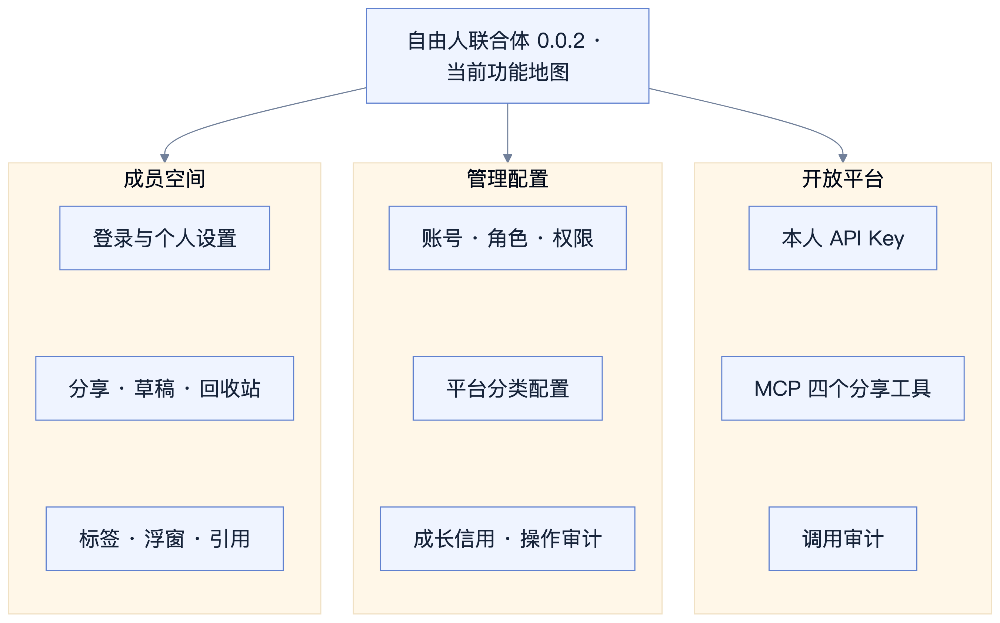

图1：成员空间、管理配置和开放平台组成当前功能地图。管理入口按账号有效权限展示，并非所有成员都能看到截图中的完整侧栏。

### 1.2 功能完成度

“已实现”指当前代码具有前后端核心链路；“部分实现”指存在可用局部能力但缺少完整闭环；“未实现”指当前可达产品中没有该能力；“待确认”用于仅凭当前源码及本次验证无法确认的环境或产品决定。

| 能力 | 状态 | 本版可用范围或缺口 |
|---|---|---|
| 短信/密码登录、个人资料、会话管理 | 已实现 | 首次短信验证自动创建成员；真实短信投递本次未验证 |
| 分享、草稿、时间线、回收站恢复 | 已实现 | 本人内容管理；没有回收站自动清理和永久删除入口 |
| 富文本、图片入口、浮窗与记录引用 | 已实现 | 图片依赖有效七牛配置；本次未做真实上传 |
| 标签新建、排序、删除与异步合并 | 已实现 | 标签属于本人；合并不重写正文 |
| 申请公开与异步审核 | 已实现 | 审核通过才公开；本次仅实拍排队状态，服务商结果未联调 |
| 面向匿名访客的分享展示页 | 部分实现 | 后端公开读取接口已具备；前端没有对应匿名路由与页面闭环 |
| 分类管理 | 已实现 | 平台分类配置、启停、编号变更和删除历史；当前未用于分享分类 |
| 分类关联任务数量与迁移任务明细 | 未实现 | 当前仓储返回 0 和空列表；不能据此宣称任务迁移闭环 |
| 账号、角色、菜单与功能权限 | 已实现 | 多角色与公共权限叠加，服务端再次校验 |
| 成长规则、信用流水与人工调整 | 已实现 | 保留业务身份与等级；没有任务事件自动成长闭环 |
| “任务模块”开关 | 部分实现 | 能保存本人开关、开通承接人身份；没有对应任务业务页面 |
| API Key、MCP 四个分享工具、调用审计 | 已实现 | 仅本人分享；不是任意业务接口开放平台 |
| 需求拆解、任务发布/大厅/承接/验收 | 未实现 | 已退出本版范围，历史名称或提示不能视作可用功能 |
| 生产配置、真实云服务可用性 | 待确认 | 需在目标部署环境单独验收，不由本文截图证明 |

## 2 用户角色与权限边界

### 2.1 三种概念分别管理

**成员账号**是登录与数据归属主体。**平台角色**决定能使用哪些模块和操作。**业务身份及等级**显示发布人、承接人的成长与信用，两者不能相互替代。

“公共权限”中的“公共”指所有正常登录账号继承的权限，并不表示匿名访客获得这些能力。有效权限为启用角色权限与公共权限的合并结果；成员可以同时拥有多个平台角色。

| 身份/角色 | 默认可用范围 | 数据与限制 |
|---|---|---|
| 匿名访客 | 登录、短信验证、密码设置/找回；后端已审核公开内容读取 | 没有个人工作空间；公开内容展示缺前端页面 |
| 普通成员 member | 个人设置、本人分享及标签、本人 API Key、本人调用审计 | 不能管理他人分享；继承公共权限，配置变更后范围可改变 |
| 运营人员 operator | 继承公共权限，额外具有成长与信用、操作审计 | 默认不具有账号/角色/权限管理能力 |
| 平台管理员 admin | 分类、账号、角色、权限、成长、操作审计及全部调用审计等内置权限 | 分享管理仍按本人归属隔离；管理员不等于可以浏览所有私密分享 |
| 自定义角色 | 管理员授予的启用权限，与其他角色合并 | 角色本身不自动生成页面或接口能力 |
| API Key 调用者 | 密钥范围与所属账号当前权限的交集 | 不是独立成员；只能操作密钥所有者的内容 |

以上是初始迁移内的默认授权，不是不可变的角色承诺。公共权限、普通成员和运营角色可在保护规则内调整；内置管理员角色权限页面只读。

### 2.2 页面与动作双重控制

| 功能 | 主要权限 | 后端数据边界 |
|---|---|---|
| 浏览本人分享 | shares.use | 当前会话/密钥所有者 |
| 新建、编辑、删除恢复 | shares.create / shares.edit / shares.delete | 还需 shares.use；标签变更需要编辑权限 |
| 分享图片上传/访问 | files.upload / files.download | 上传还需分享新建或编辑能力，媒体编号不能绕过归属 |
| 分类查看/新增/编辑/删除 | categories.read / create / edit / delete | 平台级配置；分类写权限需配合查看权限 |
| 成员管理 | accounts.manage | 修改角色还需 roles.manage |
| 角色、权限目录 | roles.manage / permissions.manage | 后端保护管理员及关键入口 |
| 成长与操作审计 | growth.manage / audit.read | 跨账号人工调整与管理记录 |
| 本人密钥/本人调用 | api-keys.view / call-audits.view | 密钥创建另需分享使用权限和对应动作权限 |
| 全部调用审计 | call-audits.read-all | 同时需要调用审计页面权限 |

本人资料、密码、安全设置和退出登录保留账号自助入口。隐藏菜单与撤销权限是两回事：隐藏仅影响导航显示；实际授权由有效权限决定。权限配置中新建一个页面节点，也不会自动开发出对应业务页面。

## 3 成员账号与个人设置

### 3.1 登录与密码

**定位与入口：** 未登录访问工作空间进入认证页面；可切换 `/login` 密码登录、`/login/sms` 验证码登录，进入 `/password/set` 设置密码或 `/password/forgot` 找回密码。认证后进入分享工作空间。

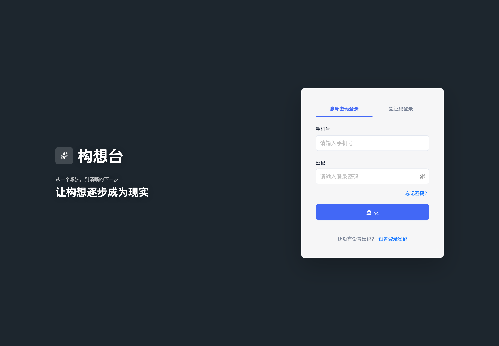

图2：真实登录页。左侧为当前品牌文案；右侧为登录方式、手机号、密码及找回入口。页面未填写真实账号或密码。

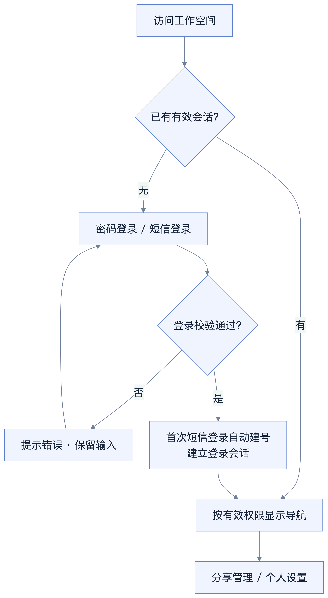

| 编号 | 页面元素 | 功能说明 | 交互行为 |
|---|---|---|---|
| AUTH-01 | 手机验证码登录 | 校验手机控制权，首次成功自动建号 | 验证码用途隔离，不可用登录验证码重置密码 |
| AUTH-02 | 密码登录 | 使用同一手机号对应的成员账号 | 未设置密码、账号不存在或密码错误统一提示认证失败 |
| AUTH-03 | 设置/找回密码 | 手机验证后写入密码 | 首次设置不能覆盖已有密码；成功后旧会话失效，重新登录 |
| AUTH-04 | 获取验证码 | 返回发送结果与冷却时间 | 页面倒计时，后端同时实施冷却、配额及验证次数限制 |
| AUTH-05 | 无法连接服务 | 区分未登录与服务不可用 | 网络/服务错误显示重试，不直接当作退出登录 |

**关键规则：** 手机号为 1 开头的 11 位数字；验证码为 6 位、5 分钟有效，最多验证 5 次，验证成功一次性消费。同手机号 60 秒冷却、每天 10 次，另有 IP 和全局限制。密码 8–64 位，必须含字母和数字，支持规定范围内可打印字符；密码登录也有限频。服务端使用不透明会话令牌和 HttpOnly Cookie，不是 JWT 登录体系，默认会话期 30 天，可由部署配置改变。

**异常与状态：** 校验失败不创建有效会话；禁用账号不能正常登录；短信未配置或服务异常会返回错误。登录能力为**已实现**，真实短信到达率及生产 Cookie 行为为**待确认**。

**实现依据：** `AuthGate.tsx`、`AuthPage.tsx`、`authApi.ts` → `AuthController` / `PasswordController` → `AuthService` / `SmsVerificationService` / `PasswordService` → 账号、验证码、会话及安全事件实体。详细路径见第11章。

### 3.2 个人资料与账号安全

**定位与入口：** 侧栏“个人设置”或底部个人信息，路由 `/system/settings`。资料、账号信息、我的身份、密码与会话安全位于同一页面。

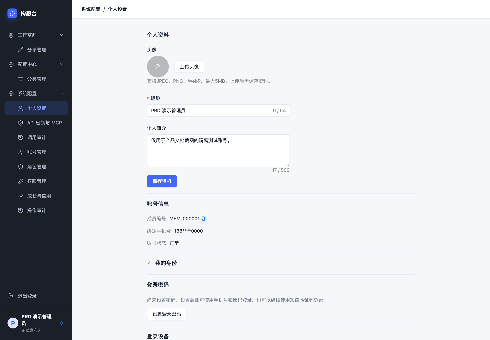

图4：个人资料区和账号信息。昵称、简介均为隔离演示内容；更多身份、安全信息位于页面下方。

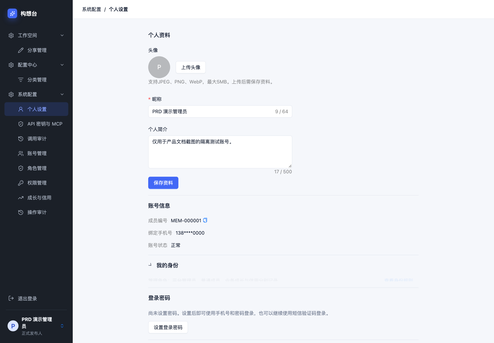

图5：展开后可查看业务身份、等级与发布资格提示。“开放任务模块”只对应身份和开关能力，不能据此进入任务大厅。

| 编号 | 页面元素 | 功能说明 | 交互行为 |
|---|---|---|---|
| ME-01 | 头像、昵称、个人简介 | 维护本人对外识别信息 | 头像上传完成后还需保存资料；昵称必填最多64字，简介选填最多500字 |
| ME-02 | 成员编号、手机号、账号状态 | 识别本人账号 | 编号可复制；手机号脱敏显示；不提供换绑或注销闭环 |
| ME-03 | 我的身份/身份规则 | 展示平台角色、业务等级、徽章、成长与信用 | 可展开规则、历史与徽章预览；不要把发布资格提示理解为任务发布可用 |
| ME-04 | 密码安全 | 查看是否设置密码，进入设置或重置 | 手机验证后完成；旧会话随密码保存撤销 |
| ME-05 | 登录设备 | 展示当前与其他有效会话 | 可撤销其他单个会话，或一键退出其他设备；当前会话通过退出登录结束 |
| ME-06 | 安全记录 | 回顾最近账号安全操作 | 显示登录、密码设置/重置、会话撤销等事件 |
| ME-07 | 开放任务模块/开关 | 首次开通承接人 J1 身份，保存本人任务模块开关 | 关闭不删除身份、不清空等级；受限身份不能靠开关恢复 |

**异常与状态：** 资料提交失败保留表单；头像上传失败独立提示；会话撤销失败可重试。个人资料和安全链路为**已实现**；任务开关属于**部分实现**，只完成身份与开关存储，当前没有任务页面。

**实现依据：** `SettingsPage` / `ProfileEditor` / `AccountSecurity` / `AccountCenter` → 用户资料、安全、身份接口 → `UserProfileService` / `AccountSecurityService` / `AccountPlatformService`。当前头像访问为本人权限预览，不能据此承诺匿名头像展示。

## 4 分享记录：记录、整理与回顾

### 4.1 分享管理与时间线

**定位与入口：** 工作空间 → 分享管理，`/shares`。此处的“分享”首先是本人记录空间，选择公开并审核通过才对外开放。

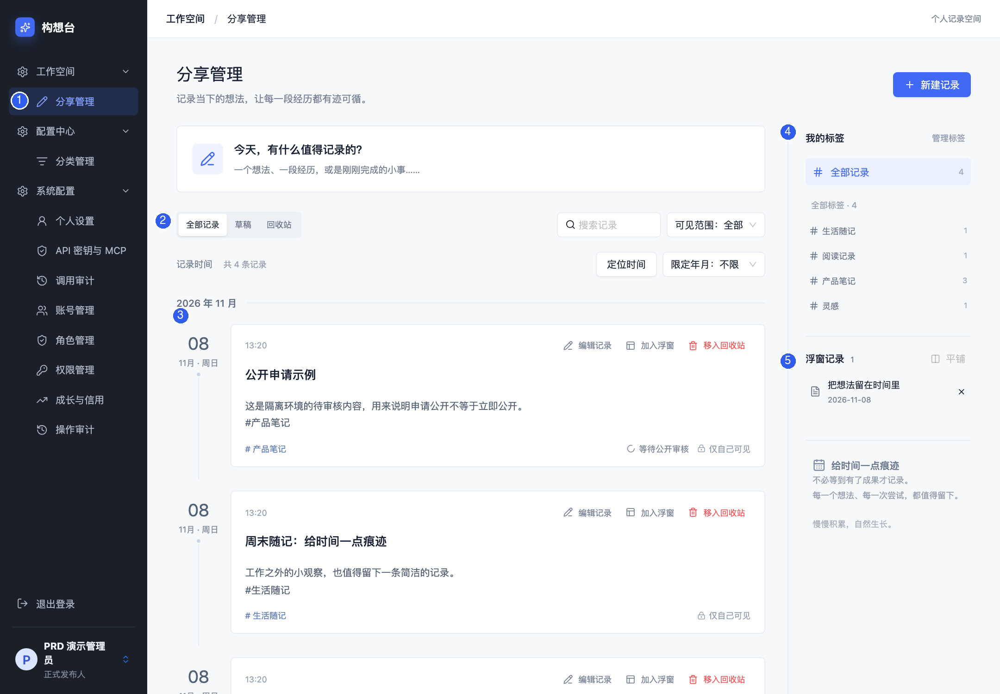

图6：①权限导航；②状态及筛选区域；③时间线与记录卡片；④本人标签；⑤浮窗记录列表。截图中“公开申请示例”显示等待审核，同时仍标注“仅自己可见”，体现申请与实际可见性的区别。

| 编号 | 页面元素 | 功能说明 | 交互行为 |
|---|---|---|---|
| SHARE-01 | 新建记录/顶部记录入口 | 打开编辑器 | 需要新建权限；未完成编辑再次操作先处理现有编辑会话 |
| SHARE-02 | 全部记录、草稿、回收站 | 切换不同内容视图 | 全部记录为正式内容；草稿含新草稿和正式记录的独立编辑副本 |
| SHARE-03 | 搜索、可见范围、标签 | 组合筛选本人内容 | 搜索短暂防抖；可清除筛选；筛选结果数量与空态联动 |
| SHARE-04 | 限定年月 | 只看指定年或月份 | 与日期定位区分，限定的是浏览范围 |
| SHARE-05 | 定位时间、回到今天 | 跳到某日期附近继续浏览 | 当天无记录展示附近日期；可跨月上下连续加载 |
| SHARE-06 | 记录卡片/详情 | 显示标题、正文、图片、标签、审核及可见性 | 点击标题打开详情；详情显示完整内容与可用引用 |
| SHARE-07 | 编辑、浮窗、回收站 | 管理单条本人记录 | 根据状态和动作权限显示；删除前确认 |

**关键规则：** 正式列表按记录发生时间排列；草稿按草稿更新时间；回收站按移入时间。列表按双向游标连续读取，不是一次拉取全部记录。改变筛选后不能复用旧分页边界。时间定位不等于只筛选某个月份。当前筛选与定位状态未写入 URL，不能承诺刷新、复制链接或浏览器返回可精确恢复。

**异常与状态：** 加载中显示进度；列表/标签失败分别可重试；不同状态分别展示“暂无记录”“暂无草稿”“回收站是空的”；筛选无结果提供清除筛选。链路为**已实现**，URL 恢复为**未实现**。

**实现依据：** `SharePage` / `useShareTimeline` / `ShareRecordContent` → `/shares/records`、`records/periods`、`records/detail` → `ShareService` / `SqlShareReadRepository` → 分享记录、标签关联和编辑副本。

### 4.2 内容编辑与保存

**定位与入口：** 新建或编辑记录打开弹窗；可切换悬浮编辑及放大编辑器。放大模式同时展示标签与浮窗辅助区。

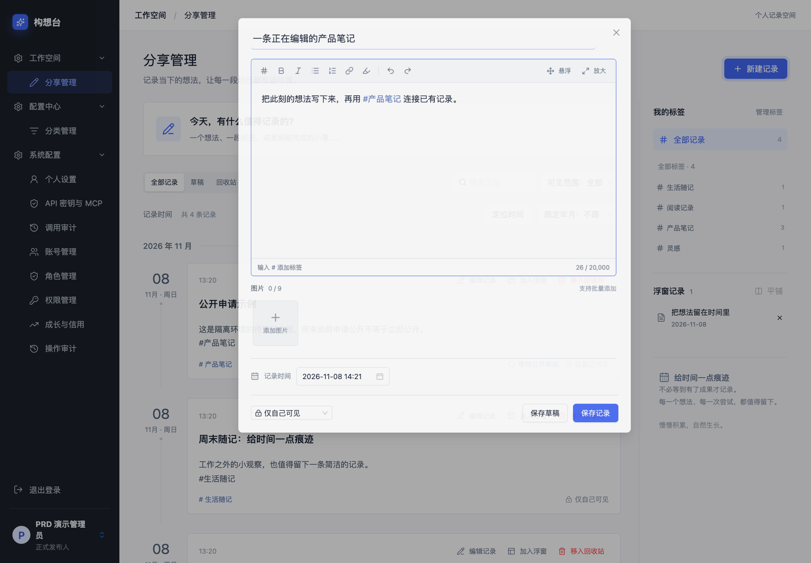

图7：标题、富文本工具、正文、图片、记录时间、可见范围和保存动作共处一个编辑流程。

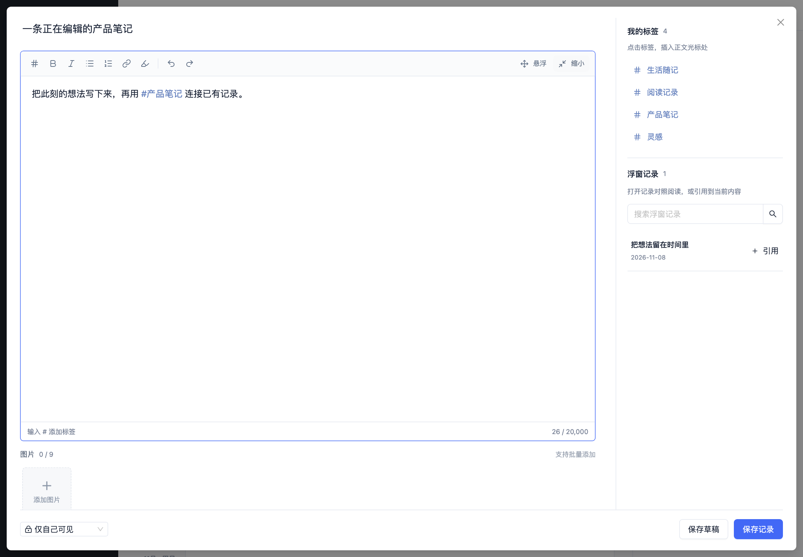

图8：主内容区用于编辑；右侧可插入已有标签，并打开或引用浮窗中的记录。此图未上传云端图片。

| 编号 | 页面元素 | 功能说明 | 交互行为 |
|---|---|---|---|
| EDIT-01 | 标题 | 可选，最多80字，不能换行 | 无标题也可形成记录 |
| EDIT-02 | 正文与格式栏 | 加粗、斜体、有序/无序列表、链接、背景高亮、撤销重做 | 正文最多20,000字；支持规定格式，不是任意 HTML 编辑器 |
| EDIT-03 | 正文标签 | 输入 # 触发标签建议，也可从辅助面板插入 | 按正文中的合法标签识别，一条记录最多10个不同标签 |
| EDIT-04 | 图片 | 批量选择、预览、移除 | 最多9张，每张10MB以内；保存时绑定已核验媒体 |
| EDIT-05 | 记录时间 | 可记录历史发生时间 | 不接受未来时间；保留带时区时间与时区标识 |
| EDIT-06 | 可见范围 | 仅自己可见/公开分享 | 公开时主按钮变为“提交公开审核” |
| EDIT-07 | 保存草稿 | 留待继续编辑 | 编辑正式记录时写入独立副本，不覆盖正式内容 |
| EDIT-08 | 保存记录/提交公开审核 | 保存正式版本 | 至少有正文、图片或引用之一；仅填标题不能正式保存 |
| EDIT-09 | 关闭及切换编辑 | 处理未保存变更 | 有变更时确认保存草稿或放弃；提交失败保持编辑器及输入 |

**关键规则：** 草稿与正式内容不是一个简单布尔开关。已有正式记录可同时拥有一个编辑副本；提交正式保存后清除副本。新建请求具有重试编号；编辑检查正式版本及副本版本，冲突时不能静默覆盖其他窗口的更新。关闭确认不等同于“自动保存”，本版没有可承诺的持续自动保存机制。

**异常与状态：** 上传中禁止提交；部分图片失败单独提示；字段错误、版本冲突及服务错误不应被描述为保存成功。编辑与保存为**已实现**；自动保存为**未实现**。

**实现依据：** `ShareEditor` / `ShareRichEditor` / `useShareEditingSession` / `useShareEditorLayout` → `records/create`、`records/save` → `ShareService.create/save` / `ShareDocuments.validate` → 分享记录与独立编辑副本。

### 4.3 浮窗与引用

**定位与入口：** 记录卡片“加入浮窗”；右侧浮窗列表；放大编辑器中的浮窗辅助面板。该能力用于对照阅读与建立记录间联系。

| 编号 | 页面元素 | 功能说明 | 交互行为 |
|---|---|---|---|
| REF-01 | 加入/移出浮窗列表 | 保存本人常用记录关联 | 不复制正文；移出列表不删除记录，也不取消已有引用 |
| REF-02 | 打开浮窗、平铺 | 同时阅读多条已保存记录 | 本地窗口布局与服务端浮窗名单分开；浮窗不是协同编辑 |
| REF-03 | 引用到当前记录 | 建立当前记录到来源记录的关联 | 最多50条、不可重复、不能引用自己，只能引用本人可用记录 |
| REF-04 | 引用标题/移除引用 | 跳转对照或取消关联 | 来源不可用时显示不可用状态，避免仍以正常记录打开 |

**关键规则：** 引用关系与内容复制不同。后台公开读取只保留可公开读取的引用摘要，不泄露私密来源、编辑副本或账号信息。普通浮窗列表与引用核心链路为**已实现**；不包含多人共享浮窗、协作写作或任意跨成员引用。

**实现依据：** `ShareFloating` / `useFloatingRecords` / `ShareEditor` → `/shares/floating`、`floating/save` 和记录保存 → `ShareService.shelfWrite` / 引用校验 → 浮窗关联与记录引用编号。

### 4.4 草稿与回收站状态

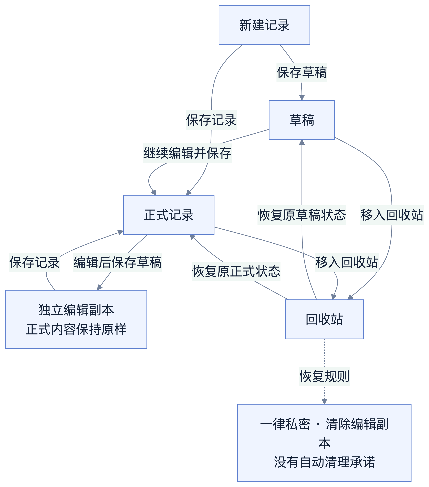

图9：状态主线与独立编辑副本。回收站恢复保留原“草稿/正式”类型，但统一恢复为私密。

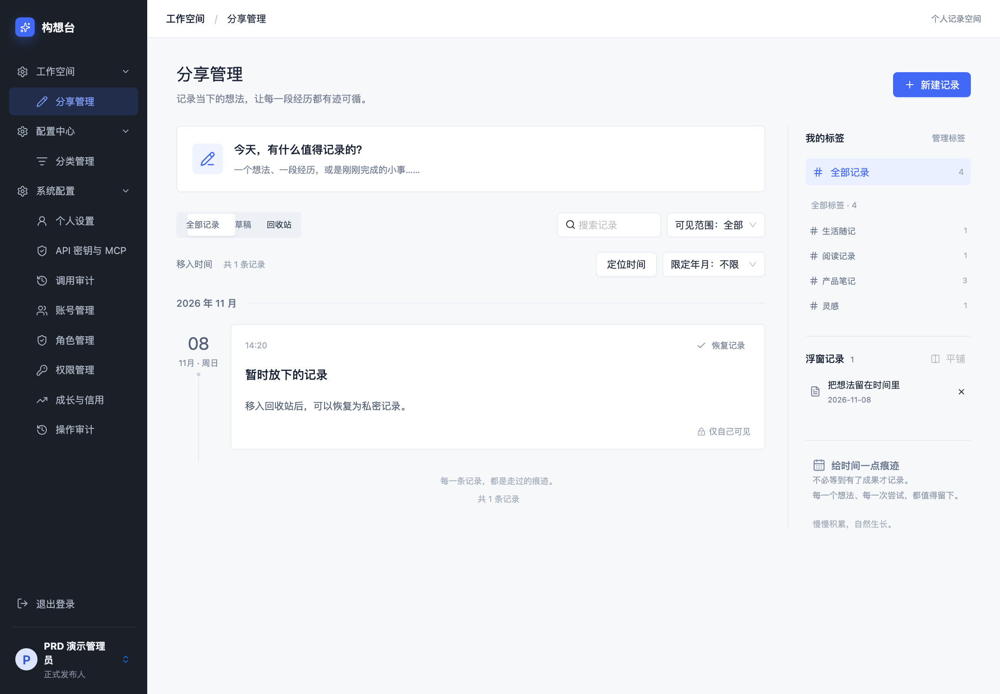

图10：隔离演示记录进入回收站后的真实页面，可使用“恢复记录”操作。

| 操作 | 内容结果 | 可见性与恢复规则 |
|---|---|---|
| 新建并保存草稿 | 产生草稿，可继续编辑 | 不公开，不发起审核 |
| 正式记录另存草稿 | 保留正式内容，并产生独立编辑副本 | 原正式内容是否公开由原版本决定，副本不公开 |
| 副本正式保存 | 更新正式版本，清除副本 | 如申请公开，按新内容重新判定审核 |
| 移入回收站 | 标记删除、清除编辑副本 | 不再公开；不是物理销毁 |
| 从回收站恢复 | 回到原草稿或正式类型 | 一律私密；如要公开需再次提交审核 |
| 永久删除/30天自动清理 | 当前没有对应产品闭环 | 不承诺自动删除时间，也没有清空回收站入口 |

移入与恢复均按版本执行，不能把已变化的记录覆盖回旧状态。回收站及恢复为**已实现**；定时清理与永久删除为**未实现**。

## 5 公开、私密与内容审核

**定位与入口：** 编辑器选择“公开分享”后提交；时间线卡片和详情显示审核状态。用户表达“希望公开”后，系统先私密保存，再异步处理。

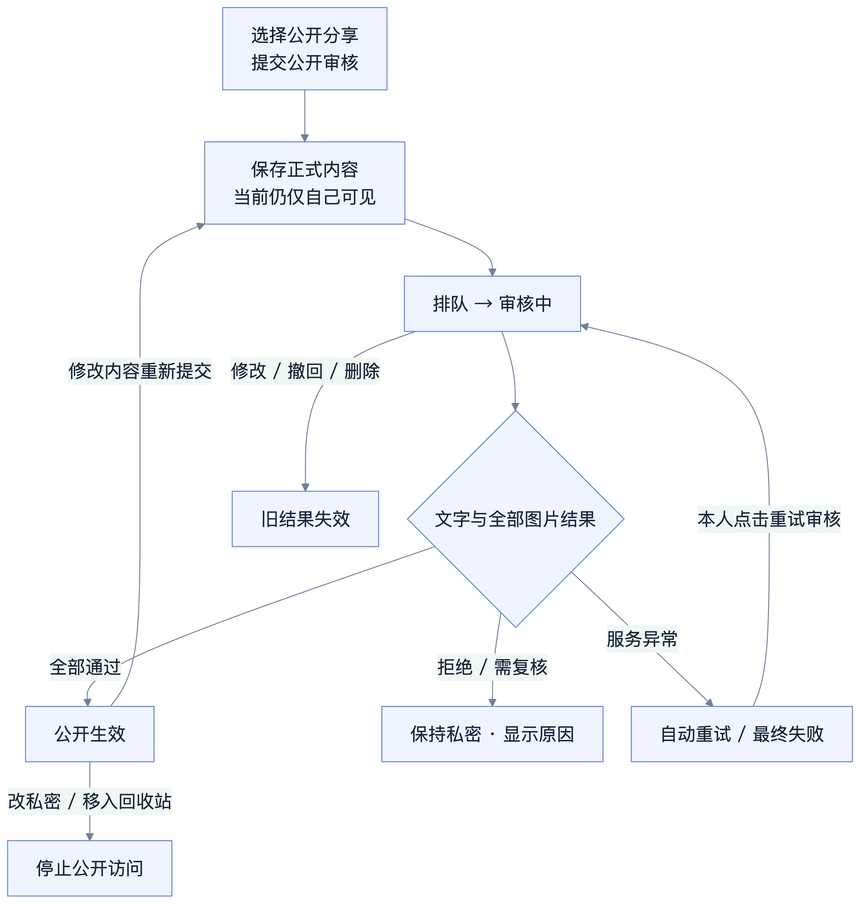

图11：只有文字与所有图片均通过，当前正式版本才公开。审核队列和进度持久化，页面不需要一直保持打开。

| 审核状态 | 用户看到/可做什么 | 实际可见范围 |
|---|---|---|
| queued / running | 等待公开审核、审核中及完成数量 | 仍仅本人可见 |
| approved | 当前版本审核通过 | 公开生效，后端可匿名读取 |
| rejected | 内容未通过，查看安全提示并修改 | 私密；不是点击重试就可绕过 |
| review_required | 结果需进一步确认 | 私密；当前没有人工审核工作台闭环 |
| failed | 审核服务暂未完成，可点击“重试审核” | 私密；仅本人当前失败任务可重试 |
| cancelled | 内容变化、撤回或删除使旧任务失效 | 旧结果不能让新内容公开 |

**关键规则：** 私密记录与草稿不创建公开审核任务。编辑公开正式内容重新保存后，若内容或策略变化，会使旧结果失效并重新审核；仅保存独立编辑副本不替换正式内容。改为私密、移入回收站或其他版本变化后，过期任务不能重新公开旧内容。图片审核缓存按用户、图片内容摘要及审核策略隔离。

**异常与状态：** 审核服务失败采用有限自动重试，最终失败显示人工重试入口；审核拒绝、需复核、服务失败有不同语义。当前没有管理端人工批准/驳回页面，不应把“需复核”写为已经流转到人工审批队列。

**实现状态：** 提交、状态展示、持久化执行及失败重试**已实现**；匿名展示前端与人工复核后台**未实现**。真实 DeepSeek 文本审核与阿里云图片审核调用本次**未验证**，不能将截图中的排队状态当作真实审核通过证据。

**实现依据：** `ShareReviewStatus` / `useShares` → `records/reviews`、`records/review/retry` → `ShareReviewRunner` / `SqlShareReviewJobs` / 两个审核适配器 → 审核任务、审核项与正式可见性。后端 `/shares/public/record` 只返回白名单公开字段。

## 6 标签、分类与图片

### 6.1 本人标签管理

**定位与入口：** 分享页“我的标签”及“管理标签”，或编辑器正文输入 #。标签是成员自己的内容组织方式，独立于平台分类。

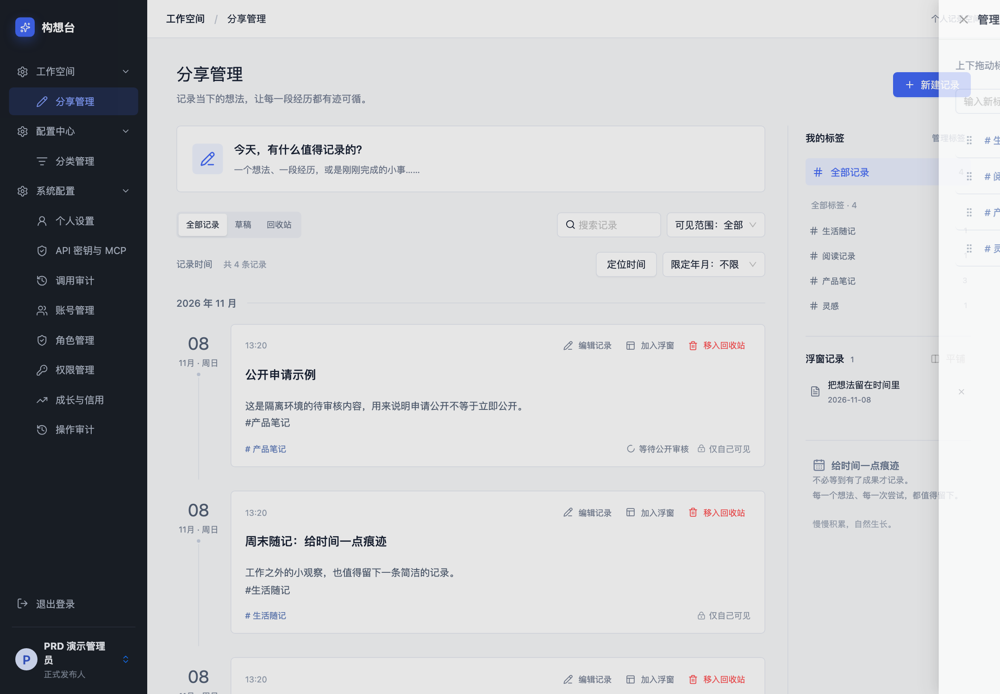

图12：新增、拖动排序、合并及删除入口。数量由当前内容关联计算，不应理解为全平台标签热度。

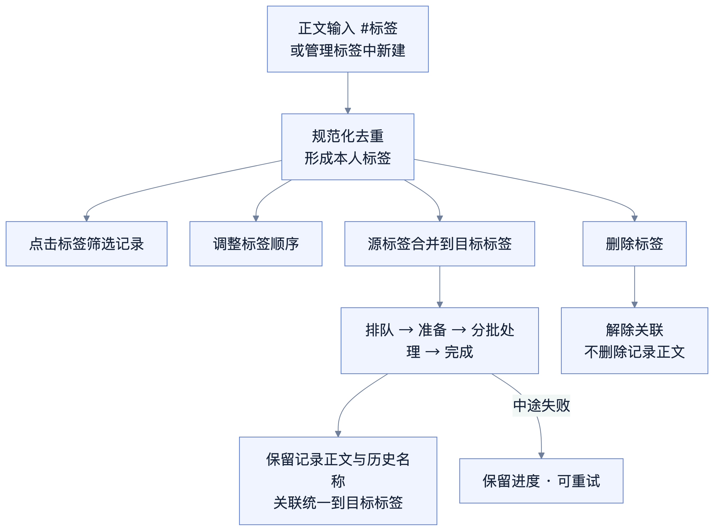

| 编号 | 页面元素 | 功能说明 | 交互行为 |
|---|---|---|---|
| TAG-01 | 正文 #标签、标签建议 | 从正文识别标签，选择已有或新名称 | 标签1–30字，不含空白或#；规范化后去重，大小写不产生两个独立标签 |
| TAG-02 | 新建标签 | 预先建立本人标签 | 已存在时复用，历史删除标签可按规则恢复 |
| TAG-03 | 拖动排序 | 调整本人标签列表顺序 | 使用排序版本，冲突需刷新而非覆盖 |
| TAG-04 | 合并 | 选择源与目标标签，提交后台任务 | 持久化排队和分批进度；失败保留断点，可重试 |
| TAG-05 | 删除标签 | 去掉标签及关联 | 不删除记录，不改写正文中的历史文字 |

**关键规则：** 合并覆盖关联正式记录、编辑副本及回收站内容，统一目标关联但保留正文历史名称。合并期间标签结构和关联写入受限制；筛选会兼顾源/目标关联，避免中途看似丢记录。失败任务仍需恢复处理，不能承诺失败后立即随意重排标签。

**异常与状态：** 标签加载失败可独立重试；并发冲突提示刷新；合并失败显示进度与重试，不把前端弹窗关闭当作任务取消。核心能力为**已实现**；不包含跨成员标签共享或全平台标签库。

**实现依据：** `ShareTagAdd` / `ShareTagSorter` / `ShareTagMerge` / `ShareTagMergeProgress` → `/shares/tags/*` → `ShareService` / `TagMergeRunner` / `SqlTagMergeJobs` → 标签、顺序、关联及合并任务。

### 6.2 平台分类配置

**定位与入口：** 配置中心 → 分类管理，`/configuration/categories`；有“分类列表”和“迁移记录”两个页签。

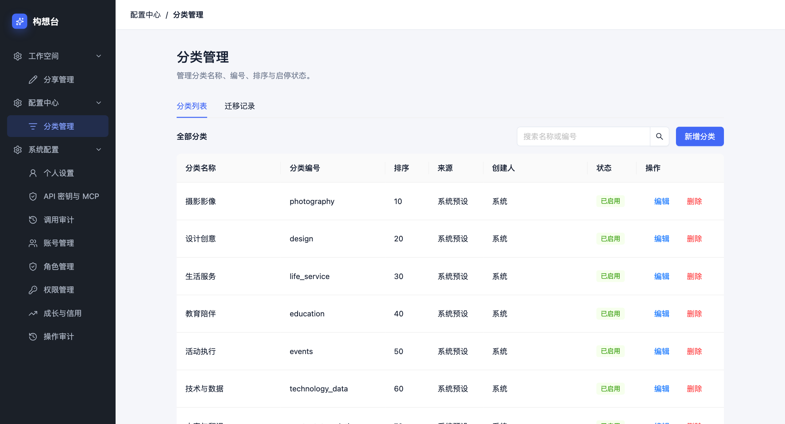

| 编号 | 页面元素 | 功能说明 | 交互行为 |
|---|---|---|---|
| CAT-01 | 搜索与分类表 | 查询名称、英文编号、顺序、启用状态 | 无权操作时隐藏相应按钮，服务端也鉴权 |
| CAT-02 | 新增/编辑 | 维护中文名称、英文编号、排序和启停 | 编号只支持小写字母与单词间下划线；名称与编号按规则唯一 |
| CAT-03 | 修改编号 | 保留旧编号追溯 | 历史编号不能随意重新分配给其他分类 |
| CAT-04 | 删除与迁移记录 | 删除分类并留下历史 | 当前可记录配置删除；任务数量固定为0、变更任务明细为空 |

**关键规则：** 分类是平台配置，不是分享记录的分类字段。不能因为页面有“关联数量”“迁移记录”就写成当前能迁移实际任务。本版真实可用的是分类配置及历史追溯；任务归类迁移业务闭环为**未实现**。

**异常与状态：** 重复编号/名称、非法编号、失效目标分类均会失败；保存失败保持编辑信息。配置 CRUD 为**已实现**，任务关联为**未实现**。

**实现依据：** `CategoryManagement` / `CategoryDeletion` / `CategoryMigrationHistory` → `/task-categories/*` → `DiscoveryService` / `CategoryEditingService` / `CategoryMigrationService` → 分类、编号历史和配置迁移记录；当前仓储 `countTasks=0`、`changedTasks=[]`。

### 6.3 分享图片、头像与存储

**定位与入口：** 编辑器图片区和个人资料头像区。当前提供图片，不是通用文件网盘或任意附件管理器。

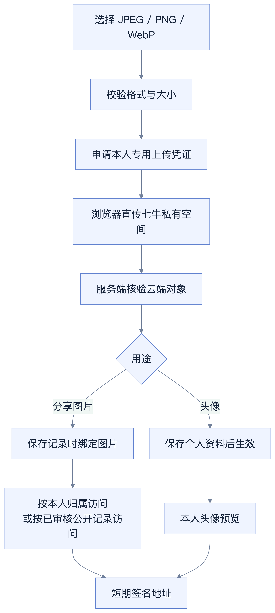

| 项目 | 分享图片 | 成员头像 |
|---|---|---|
| 格式 | JPEG、PNG、WebP | JPEG、PNG、WebP |
| 大小 | 单张最多10MB | 单张最多5MB |
| 数量 | 每条记录最多9张 | 资料保存一个当前头像编号 |
| 保存生效 | 上传核验后，保存记录绑定 | 上传核验后，保存资料生效 |
| 访问方式 | 本人访问；或经当前已审核公开记录授权 | 当前本人权限预览 |
| 删除语义 | 编辑器移除绑定不等于立刻删除七牛对象 | 更换头像不等于清除旧云对象 |

**关键规则：** 后端签发限定用途和对象的上传凭证，浏览器直传七牛私有空间；完成后核验云对象实际大小、类型及内容摘要，再登记可用。不能只凭浏览器声称“上传成功”绑定任意对象。读取时重新检查归属或公开记录资格，然后重定向到短期签名地址；已经签发的地址在其有效期内仍可能可用，不承诺立即失效。

**异常与状态：** 格式、数量、大小不符阻止上传；未核验/跨账号媒体不能保存到记录；存储未配置会失败提示。接入与业务校验链路**已实现**；真实上传、云域名与防盗链配置本次**待确认**。全局上传配额、孤立对象自动清理没有完整产品闭环。

**实现依据：** `shareApi` / `avatarApi` → 分享及头像 upload-token、complete、content → `ShareMediaService` / `AvatarService` / 统一存储适配器 → 分享媒体、上传台账及记录媒体关联。

## 7 管理端：成员、角色与权限目录

### 7.1 成员账号管理

**定位与入口：** 系统配置 → 账号管理，`/system/accounts`。用于维护已存在成员，不是后台批量开户工具。

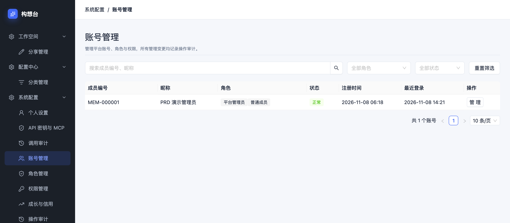

| 编号 | 页面元素 | 功能说明 | 交互行为 |
|---|---|---|---|
| ADM-01 | 搜索及筛选 | 按关键词、角色和正常/禁用状态查找 | 服务端分页；状态与角色按当前有效配置展示 |
| ADM-02 | 账号信息行 | 显示成员编号、昵称、脱敏手机号、角色、状态及时间 | 不展示密码、会话令牌或密钥全文 |
| ADM-03 | 编辑角色/账号状态 | 保存多个角色和正常/禁用状态 | 改角色需要角色管理权限，不能只靠账号管理权限 |
| ADM-04 | 保护与审计 | 防止失去管理入口 | 禁止停用本人或移除最后有效管理员；变更写入操作审计 |

**异常与状态：** 列表失败可重试；非法角色、已停用角色及并发状态变化按后端结果提示；受保护操作不能静默成功。成员管理为**已实现**，没有成员物理删除、后台修改他人正文或密码明文查看能力。

**实现依据：** `AccountManagement` → `/admin/users/page`、`users/save` → `AccountPlatformService.searchUsers/saveAccount` → 账号、角色分配和操作审计。

### 7.2 角色与公共权限

**定位与入口：** `/system/roles`；新建 `/system/roles/new`；编辑 `/system/roles/{角色编码}/edit`。角色页面有“角色列表”和“公共权限”页签。

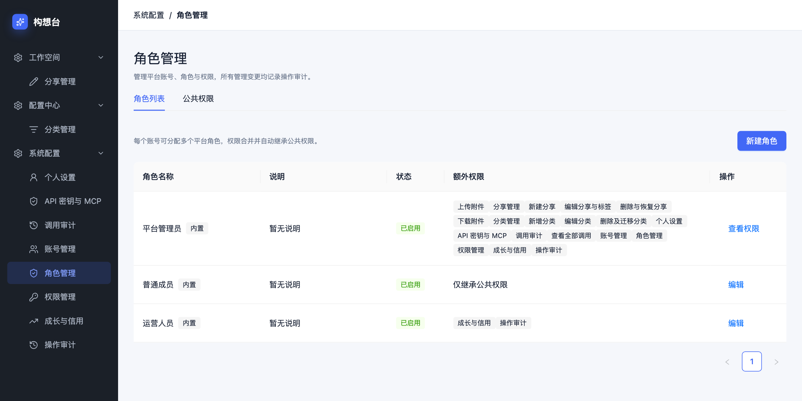

| 编号 | 页面元素 | 功能说明 | 交互行为 |
|---|---|---|---|
| ROLE-01 | 角色列表 | 查看名称、说明、状态和额外权限 | 普通成员默认可以仅继承公共权限 |
| ROLE-02 | 新建/编辑 | 定义自有角色与授权集合 | 名称最多40字、说明最多300字；版本冲突需重新读取 |
| ROLE-03 | 内置管理员 | 查看全部内置管理权限 | 权限只读，不能按普通角色修改 |
| ROLE-04 | 公共权限 | 所有正常登录账号继承 | 只可选择被标记允许公共授权的能力，不能把关键管理能力开放给全部成员 |
| ROLE-05 | 启停 | 控制角色是否有效 | 正在分配的角色不能直接停用；公共及成员角色有保护规则 |

**关键规则：** 多角色按并集生效；角色停用或权限停用影响实际有效授权。分类写权限需要分类查看权限。授权不是给某个前端按钮换个名字，后台应用服务会再次校验。

**实现状态：已实现。** 当前 UI 提供新建、编辑、启停及公共授权，没有通用“删除角色”产品入口。

**实现依据：** `RoleManagement` / `RoleEditor` → `/admin/roles/*` → `RoleService` / 角色仓储 → 角色定义、角色权限及账号角色分配。

### 7.3 菜单与功能权限目录

**定位与入口：** `/system/permissions`。左侧资源目录，右侧详情；分“菜单与权限”“通用能力权限”。

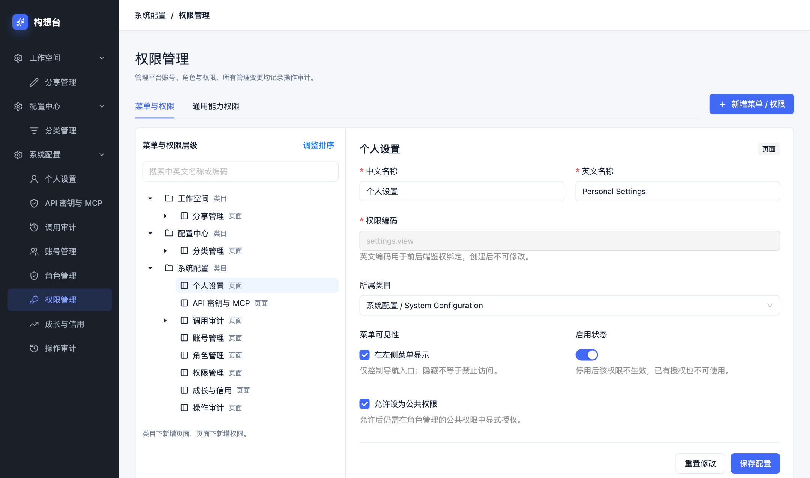

| 编号 | 页面元素 | 功能说明 | 交互行为 |
|---|---|---|---|
| PERM-01 | 层级树与资源搜索 | 查看类目、页面与操作权限 | 可选节点查看详情，调整顺序与父级 |
| PERM-02 | 新建资源 | 登记权限编码、中英文名称与说明 | 创建后编码及节点类型不可改；不自动生成前端页面或后端接口 |
| PERM-03 | 启用与菜单可见 | 分开维护有效性与导航呈现 | 隐藏不等于撤销授权，导航只显示已启用且可见的获权页面 |
| PERM-04 | 允许公共授权 | 允许被公共权限选择 | 必须先移除公共授权，才能取消允许标记 |
| PERM-05 | 关键入口保护 | 保持账号/角色/权限管理可达 | 不得停用、隐藏或改为公共授权；层级不可循环或超限 |

**异常与状态：** 非法父节点、循环、重复编码、超层级、并发版本冲突均拒绝；批量排序以一个事务完成。目录管理为**已实现**；“配置即生成新业务功能”属于**未实现且不能据此推断**。

**实现依据：** `PermissionManagement` / `navigationBindings` / `Sidebar` → `/admin/permissions/*`、`/users/navigation` → `PermissionService` / `BusinessPermissionConfig` → 权限目录、授权关系。

## 8 成长信用与两类审计

### 8.1 成长与信用

**定位与入口：** 管理端 `/system/growth`，含成长规则及人工调整；成员在个人设置查看本人身份、等级及历史。

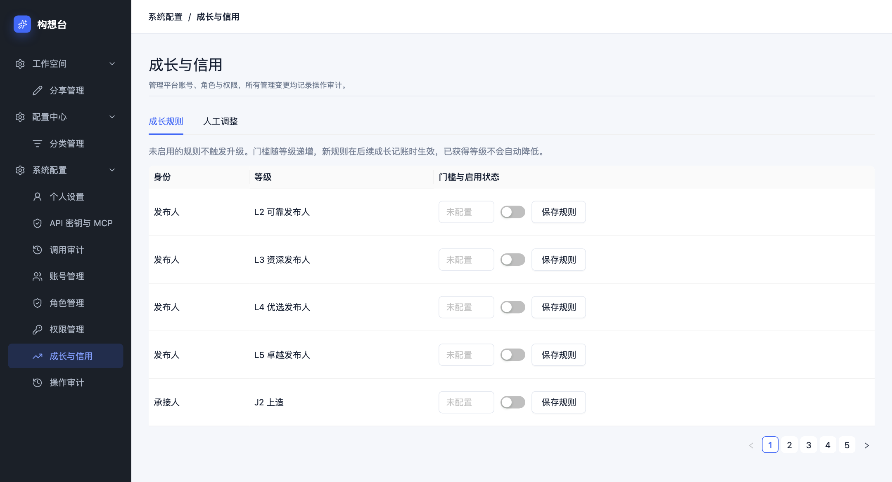

| 编号 | 页面元素 | 功能说明 | 交互行为 |
|---|---|---|---|
| GROW-01 | 等级规则 | 展示发布人 L 系列和承接人 J 系列规则、徽章 | 规则维护使用现有等级，未配置门槛不自动升级 |
| GROW-02 | 门槛与启用 | 配置成长门槛及规则开关 | 基础资格等级受保护；启用规则的门槛必须严格递增 |
| GROW-03 | 人工调整 | 指定成员、业务身份、成长或信用、变化值和原因 | 变化值非0且在规定范围内；成长不能减成负数 |
| GROW-04 | 流水与幂等 | 记录可追溯的调整事件 | 重试同一事件不重复加分；同编号不同内容拒绝 |

**关键规则：** 成长与信用分别记录。成长增加符合启用门槛时可升级；减少成长不自动降低现有等级。信用变化不触发成长等级变化。当前没有“做任务自动加分”或“分享获赞自动成长”的业务闭环。

**异常与状态：** 找不到成员/身份、账号受限、门槛非法、并发规则版本变化会拒绝。身份、规则与人工流水为**已实现**；业务事件自动成长为**未实现**。

**实现依据：** `AdminPanel` / `AccountCenter` → `/users/level-rules`、`/admin/level-rules/save`、`/admin/identities/adjust` → `AccountPlatformService.saveRule/record` → 身份档案、等级规则、成长信用流水。

### 8.2 管理操作审计

**定位与入口：** `/system/audits`，需要 `audit.read`。用于追溯平台管理和身份相关操作。

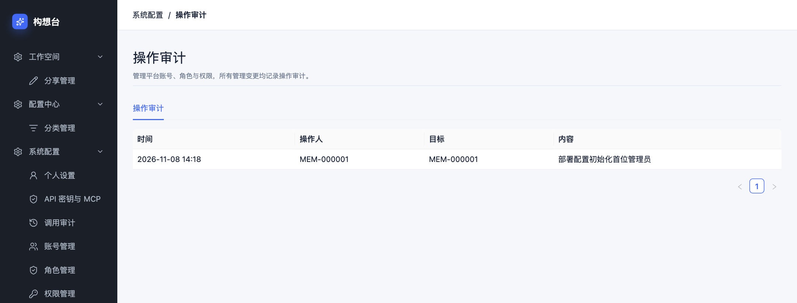

| 编号 | 页面元素 | 功能说明 | 交互行为 |
|---|---|---|---|
| AUD-01 | 操作记录表 | 查看时间、操作者、动作、对象和详情 | 只读查询，不提供修改/清空记录入口 |
| AUD-02 | 管理变更详情 | 回顾账号状态、角色授权、权限配置、成长调整等 | 与业务保存一起记录，不能理解为记录了每次页面点击 |

**实现状态：已实现。** 不把管理操作审计描述为分享正文版本库、内容审核后台或外部客户端调用明细；后三者有不同数据边界。

**实现依据：** `AdminPanel` 审计区 → `/admin/audits` → `AccountPlatformService.audits` → `account_audit`。

## 9 开放平台：API Key、MCP 与调用审计

### 9.1 API 密钥与连接引导

**定位与入口：** `/system/api-keys`。管理本人密钥，查看 MCP 服务地址、客户端配置示例、检查命令和密钥诊断。

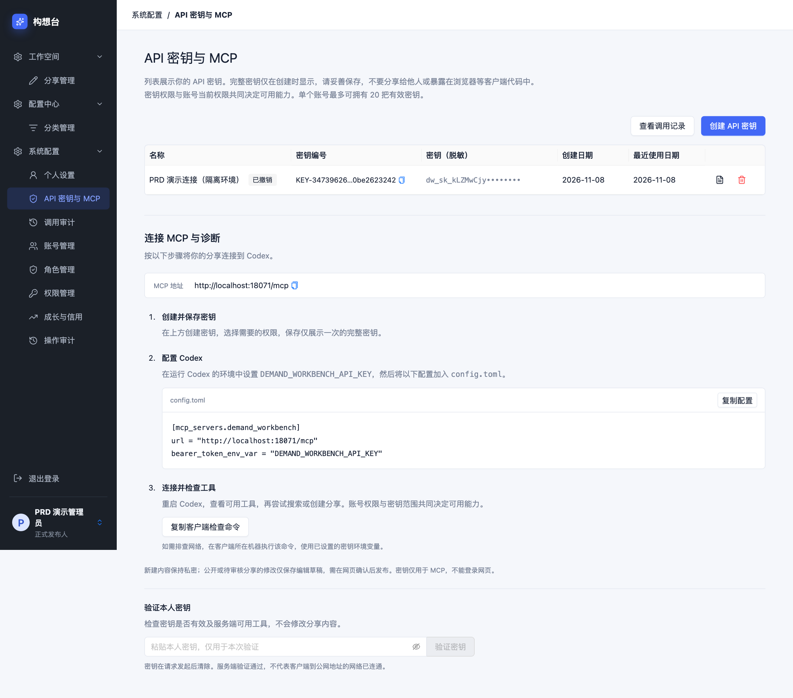

图21：演示密钥已撤销，列表只显示脱敏信息；配置示例中的密钥为占位符。完整密钥未进入截图。

| 编号 | 页面元素 | 功能说明 | 交互行为 |
|---|---|---|---|
| KEY-01 | 密钥列表与详情 | 查看名称、编号、脱敏前缀、范围、有效期和最近使用 | 按有效/过期/撤销区分，不提供再次查看完整密钥 |
| KEY-02 | 创建 | 输入名称、读取/创建/更新范围、有效天数 | 名称最多64字；单账号最多20把有效密钥；有效天数0表示永久，其他最多365天 |
| KEY-03 | 首次密钥展示 | 保存连接所需的完整凭据 | 仅创建成功的当前弹窗显示，关闭后不再恢复；遗失应新建 |
| KEY-04 | 删除 | 使本人密钥不可继续认证并从列表移除 | 弹窗确认；后端另有撤销接口，前端列表主要提供删除入口 |
| KEY-05 | 配置复制与诊断 | 复制 MCP 地址、客户端配置、检查命令，验证某把密钥 | 输入诊断密钥不修改分享；显示可用工具及请求编号 |

**关键规则：** 密钥范围不替代平台授权；创建范围不能超过账号已有对应操作能力。每次实际调用重新检查账号状态、分享权限与密钥范围；角色变更后不能依赖旧密钥继续获得已撤销能力。永久密钥仍可能因撤销、删除、账号禁用或权限收回失效。

**异常与状态：** 超限、非法范围或权限不足不创建；复制失败可手动复制；诊断失败给出错误与请求追踪信息。能力为**已实现**；没有密钥自动轮换、第三方 OAuth 授权、任意模块开放接口承诺。

**实现依据：** `ApiKeysPage` / `ApiKeySettings` / `McpConnectionGuide` → `/open-platform/keys/*` → `ApiKeyService` / `McpDiagnosticsController` → 密钥元数据和安全摘要。

### 9.2 MCP 能力与写入边界

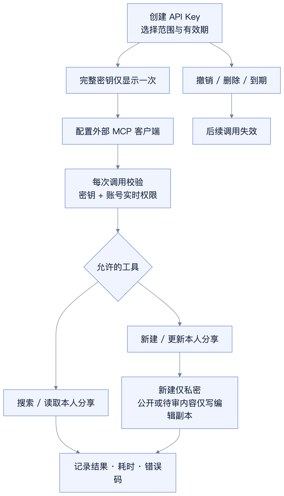

| 工具 | 所需范围 | 当前行为 |
|---|---|---|
| search_shares | shares:read | 搜索本人正式记录或草稿，按游标分页；不提供全平台搜索 |
| get_share | shares:read | 读取本人详情及版本，供后续安全更新 |
| create_share | shares:create | 创建本人私密正式记录或草稿；正文为纯文本，不解析 Markdown，不自动公开 |
| update_share | shares:update | 完整替换本人正文，保留图片与引用；必须携带当前版本，已有副本还需副本版本 |

**关键规则：** 更新原本公开或申请公开的记录时，MCP 强制保存编辑副本，不直接改为公开正式内容。用户回网页审阅后再提交。创建重试要复用请求编号和发生时间，避免重复记录。服务端工具列表按密钥有效范围裁剪，工具调用仍再次校验。

**协议附注：** 接入端点为 POST `/mcp`，使用 Bearer API Key；浏览器 Cookie 不能代替 MCP 密钥。协议工具集合限上述四项，不支持通过 MCP 管理平台账号、删除记录、上传图片、审批内容或直接公开。

**实现状态：已实现。** 本次隔离环境已通过接口实际执行一次搜索调用并生成审计；没有连接外部客户端做完整会话验收。

**实现依据：** `McpController` / `McpRequestFilter` / `ShareTools` → 原有分享用例、密钥权限与调用审计；MCP 不是第二套独立分享数据。

### 9.3 调用审计

**定位与入口：** `/system/call-audits`，也可从密钥页进入。追踪 MCP 与密钥诊断结果，与第8章的管理操作审计不同。

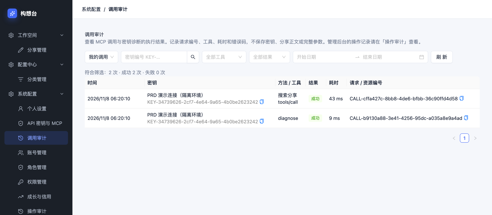

| 编号 | 页面元素 | 功能说明 | 交互行为 |
|---|---|---|---|
| CALL-01 | 查看范围 | 默认我的调用 | 只有额外权限者可切换全部账号，并按成员编号筛选 |
| CALL-02 | 条件区 | 密钥编号、工具、结果、起止时间 | 改条件重置页码，可手动刷新 |
| CALL-03 | 统计 | 匹配总数、成功数、失败数 | 与筛选条件一致；执行中记录不等同于失败 |
| CALL-04 | 明细 | 时间、账号、密钥、工具、资源、结果、耗时、请求编号和错误码 | 不保存完整密钥、分享正文或完整调用参数 |

**异常与状态：** running / success / error 分别为执行中、成功、失败；服务中断可留下执行中痕迹。普通成员不能通过改请求参数切换为全量范围。调用审计为**已实现**；不是模型思考过程、内容全文存档或无限期日志留存承诺。

**实现依据：** `CallAuditsPage` → `/open-platform/call-audits` → `CallAuditService` / 查询仓储 → `api_call_audit`。

## 10 核心对象与当前能力边界

### 10.1 产品数据关系

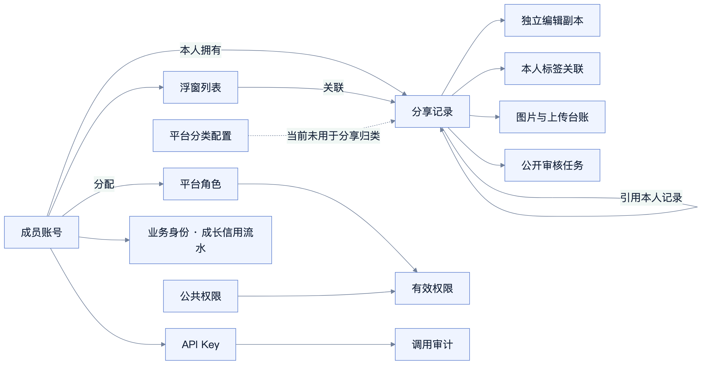

图24：图中的线表示产品逻辑关联，不表示数据库物理外键。平台分类当前没有参与分享记录归类。

| 对象 | 谁拥有/管理 | 产品意义 |
|---|---|---|
| 成员与会话 | 成员本人；平台管理账号状态 | 登录主体和数据归属基础 |
| 平台角色、权限、公共权限 | 获得相应管理权限的账号 | 控制页面、动作和通用能力 |
| 分享记录及编辑副本 | 本人 | 正式内容与尚未提交的修改分别保存 |
| 标签与浮窗关联 | 本人 | 不复制正文的个人整理工具 |
| 媒体与上传台账 | 上传者本人，按场景绑定 | 验证媒体确属本人且已经完成上传核验 |
| 审核任务 | 系统异步处理，成员查看本人结果 | 决定当前正式内容能否公开 |
| API Key 与调用审计 | 本人密钥；跨账号查看需额外授权 | 外部工具使用本人权限，不产生新的内容所有者 |
| 业务身份、成长与信用 | 本人查看，指定管理者调整 | 等级与流水展示，未接通任务业务 |
| 平台分类 | 分类管理员 | 独立配置和历史追溯，不能视为分享标签 |

### 10.2 需要共同确认的产品问题

以下为讨论项，不是已经决定要新增的需求，也不在本次修改业务源码。

| 编号 | 当前事实 | 待确认问题 | 对文档的当前处理 |
|---|---|---|---|
| OPEN-01 | 页面品牌仍为构想台 | 是否统一更名为自由人联合体，哪些界面随版本调整？ | 保留真实页面，注明两种名称 |
| OPEN-02 | 公开读取后端已具备，匿名页缺失 | 公开能力是否作为本版正式交付目标，入口和分享链接如何设计？ | 标注部分实现，不虚构匿名页面截图 |
| OPEN-03 | 需复核结果保持私密，无人工审核工作台 | 是仅允许修改重投，还是后续建设人工复核流程？ | 不承诺已自动转人工 |
| OPEN-04 | 个人设置仍展示发布资格、任务模块开关 | 内测版是否隐藏这些历史身份入口，或保留为兼容功能？ | 说明仅身份/开关可用，任务功能未实现 |
| OPEN-05 | 分类配置独立存在，关联任务数量为0 | 分类在下一版服务哪个业务对象？ | 不将其写为分享分类或任务迁移闭环 |
| OPEN-06 | 回收站可恢复，没有自动清理 | 是否需要保留期、永久删除及云对象清理产品规则？ | 不承诺30天自动删除 |
| OPEN-07 | 当前没有 URL 筛选恢复、持续自动保存 | 是否列入后续易用性范围？ | 作为边界，不混进当前交互说明 |
| OPEN-08 | 云服务依赖配置，未做本次真实联调 | 目标环境短信、私有桶、域名与审核服务由谁验收？ | 保留待确认，不以测试替身证明生产可用 |
| OPEN-09 | 调用与管理审计已保存 | 留存周期、导出、归档、告警是否需要另行定义？ | 不附加未实现的保留期承诺 |

### 10.3 验证覆盖与未覆盖

本次只读取业务源码并生成文档、图表及项目专用 Skill。截图来自当前前端源码与同源后端构建，Java/SQL 内容经对照一致；后端使用独立临时 MySQL，前端单独端口运行。演示内容明确为合成测试数据，不使用当前开发数据库的账号或记录。

实际验证了认证后主要页面渲染、新建编辑器、放大模式、标签管理、密钥诊断与 MCP 搜索审计；主要页面截图过程未出现页面运行时异常。登录截图使用未输入凭据的真实页面。没有对业务源码做调整，也没有运行与文档变更无关的全量构建或测试。

本次未做真实付费审核、真实云存储上传、短信投递、匿名页、人工复核、外部 MCP 客户端和生产部署验收；没有生成这些未完成能力的假截图。审核通过/拒绝、合并恢复及数据隔离规则还参考现有集成测试，不能把“测试覆盖”写成“本次真实服务商验收通过”。

## 11 技术实现索引与复用资产

### 11.1 源码路径约定

前端根目录：`/Users/mainto/Documents/Codex/2026-09-30/https-chatgpt-com-share-6abcced2-9a98/demand-workbench`。

后端根目录：`/Users/mainto/javafile/demand-workbench-backend`。下表的 F/、B/ 分别相对这两个目录，定位到当前基线，不代表跨版本稳定行号。

| 功能 | 前端定位 | API / 后端定位 |
|---|---|---|
| 路由与导航 | F/src/app/router.tsx；F/src/App.tsx；F/src/features/account/navigation.ts | /users/navigation；B/src/main/java/com/demandworkbench/identity/application/PermissionService.java |
| 认证与会话 | F/src/features/auth/components/AuthGate.tsx；F/src/features/auth/api/authApi.ts | /auth/sms/\*、/auth/password/\*；B/.../identity/application/AuthService.java、PasswordService.java、SmsVerificationService.java |
| 资料与安全 | F/src/features/auth/pages/SettingsPage.tsx；components/ProfileEditor.tsx、AccountSecurity.tsx | /users/profile/save、/users/sessions；B/.../identity/application/UserProfileService.java、AccountSecurityService.java |
| 分享时间线 | F/src/features/shares/SharePage.tsx；hooks/useShareTimeline.ts | /shares/records、records/periods；B/.../shares/infrastructure/SqlShareReadRepository.java |
| 内容编辑与副本 | F/src/features/shares/ShareEditor.tsx；ShareRichEditor.tsx；hooks/useShareEditingSession.ts | /shares/records/create、records/save；B/.../shares/application/ShareService.java、ShareDocuments.java |
| 浮窗与引用 | F/src/features/shares/ShareFloating.tsx；hooks/useFloatingRecords.ts | /shares/floating、floating/save；B/.../shares/application/ShareService.java |
| 审核与公开 | F/src/features/shares/ShareReviewStatus.tsx；hooks/useShares.ts | /shares/records/reviews、review/retry、public/record；B/.../shares/infrastructure/SqlShareReviewJobs.java |
| 标签与合并 | F/src/features/shares/ShareTagMerge.tsx；ShareTagSorter.tsx；ShareTagMergeProgress.tsx | /shares/tags/\*；B/.../shares/application/TagMergeRunner.java；infrastructure/SqlTagMergeJobs.java |
| 图片与头像 | F/src/features/shares/api/shareApi.ts；F/src/features/auth/api/avatarApi.ts | /shares/media/\*、/users/avatar/\*；B/.../shares/application/ShareMediaService.java；identity/application/AvatarService.java |
| 分类 | F/src/features/categories/pages/CategoryManagement.tsx；components/CategoryDeletion.tsx | /task-categories/\*；B/.../discovery/application/CategoryEditingService.java、CategoryMigrationService.java |
| 成员与成长 | F/src/features/account/components/AccountManagement.tsx、AdminPanel.tsx、AccountCenter.tsx | /admin/users/\*、/admin/identities/adjust；B/.../identity/application/AccountPlatformService.java |
| 角色与权限 | F/src/features/account/components/RoleManagement.tsx、PermissionManagement.tsx | /admin/roles/\*、/admin/permissions/\*；B/.../identity/application/RoleService.java、PermissionService.java |
| 密钥与 MCP | F/src/features/open-platform/components/ApiKeySettings.tsx、McpConnectionGuide.tsx | /open-platform/keys/\*、POST /mcp；B/.../openplatform/application/ApiKeyService.java；mcp/application/ShareTools.java |
| 两类审计 | F/src/features/account/components/AdminPanel.tsx；F/src/features/open-platform/pages/CallAuditsPage.tsx | /admin/audits、/open-platform/call-audits；B/.../openplatform/application/CallAuditService.java |

其中 B/... 统一展开为 B/src/main/java/com/demandworkbench，不是省略未知实现。F/ 行中未重复目录的并列文件均在同一目录。

### 11.2 关键规则代码定位

| 规则 | 当前源码位置 |
|---|---|
| 无匿名分享前端路由 | F/src/app/router.tsx:5；F/src/features/auth/components/AuthGate.tsx:10 |
| 保存正式/独立副本及版本校验 | B/src/main/java/com/demandworkbench/shares/application/ShareService.java:103，方法 save |
| 恢复一律私密 | B/src/main/java/com/demandworkbench/shares/application/ShareService.java:163，方法 trash |
| 标题、正文、图片、标签限制 | B/src/main/java/com/demandworkbench/shares/application/ShareDocuments.java:48，方法 validate |
| 公开读取白名单及引用过滤 | B/src/main/java/com/demandworkbench/shares/application/ShareService.java:201，方法 publicDetail |
| 公开申请不立即公开 | B/src/main/java/com/demandworkbench/shares/infrastructure/SqlShareReviewJobs.java:136，方法 reconcile |
| 页面与具体动作权限映射 | B/src/main/java/com/demandworkbench/config/BusinessPermissionConfig.java:49，operationFor / permissionFor |
| 公共权限不是匿名权限 | B/src/main/java/com/demandworkbench/identity/application/RoleService.java:32，方法 save；账号仓储有效权限查询 |
| 分类任务计数与明细空实现 | B/src/main/java/com/demandworkbench/discovery/infrastructure/persistence/MyBatisCategoryMigrationRepository.java:23、33 |
| 成长减少不自动降级、信用独立 | B/src/main/java/com/demandworkbench/identity/application/AccountPlatformService.java:107，方法 record |
| MCP 公开记录仅写副本 | B/src/main/java/com/demandworkbench/mcp/application/ShareTools.java:69，方法 call |
| 密码保存撤销旧会话 | B/src/main/java/com/demandworkbench/identity/infrastructure/persistence/MyBatisCredentialRepository.java:29，方法 savePassword |

### 11.3 数据与第三方依赖

数据库以当前 Flyway `src/main/resources/db/migration/V202611080100__initial_release_schema.sql` 为结构依据，包含37张业务及控制表，另有 Flyway 自身版本表。主要逻辑关联通过成员编号、记录编号、标签编号和任务编号维护，不创建物理外键。当前工程使用 MySQL，不可将测试容器能力理解为生产备份或运维方案已完成。

| 业务域 | 关键表 |
|---|---|
| 账号与权限 | sys_user、sys_user_role、sys_role、sys_permission、sys_role_permission、user_session、sms_challenge |
| 分享与组织 | share_record、share_working_copy、share_tag、share_record_tag、share_float_item |
| 媒体与审核 | media_upload、share_media、share_record_media、share_review_job、share_review_item |
| 合并任务 | share_tag_order、share_tag_merge_job、share_tag_merge_item |
| 身份与管理 | user_business_identity、publisher_profile、contractor_profile、identity_level_rule、identity_ledger、identity_credit、account_audit |
| 分类与开放平台 | task_category、task_category_code_history、task_category_migration、open_api_key、api_call_audit |

第三方依赖包括阿里云短信认证、七牛私有存储、DeepSeek 文字审核、阿里云图片审核；登录背景图有 Bing 来源适配。真实服务凭据均不进入 PRD。AI 当前用途为公开内容审核，不包含已经下线的 AI 需求拆解。

### 11.4 测试与素材索引

后端 `src/test/java/com/demandworkbench/shares/ShareIntegrationTest.java` 覆盖分享隔离、编辑副本、标签合并断点恢复、图片归属、双向时间定位、公开审核和过期结果失效等规则；开放平台、身份及权限还有对应测试。前端相关 Hook、API 和审核状态组件也有单元测试。本次以其断言辅助理解当前行为，没有重新执行全量测试，不将之前测试结果作为本次通过声明。

本地内容源为 `docs/product/自由人联合体-0.0.2-产品说明与功能PRD.md`；真实页面截图、8份 Mermaid 源码及其 PNG/SVG 统一存放在 `docs/product/assets/0.0.2/`。源码反向梳理与飞书发布的复用流程位于 `.agents/skills/codebase-to-feishu-prd/SKILL.md`。

本稿先用于确认“现状是否描述准确、重点是否清楚”。第10章讨论项经确认后，再形成后续版本需求与验收标准，不在现状文档中预先承诺。
